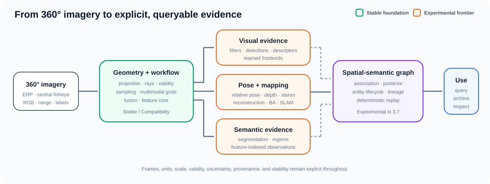
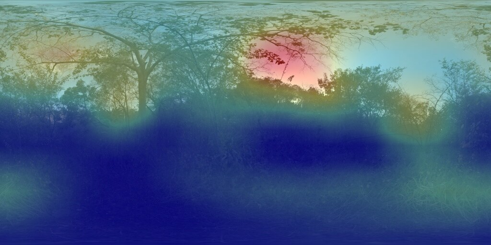
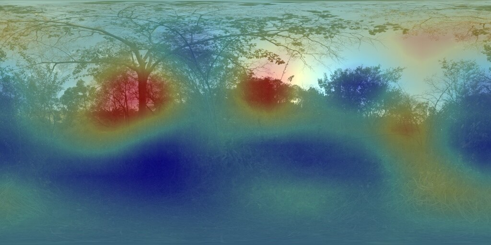
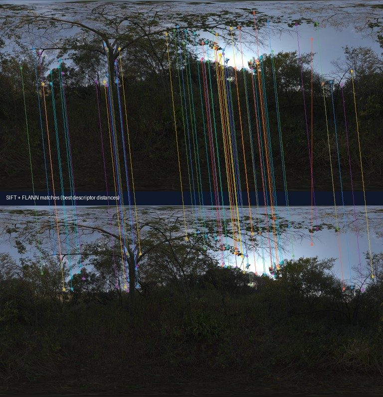
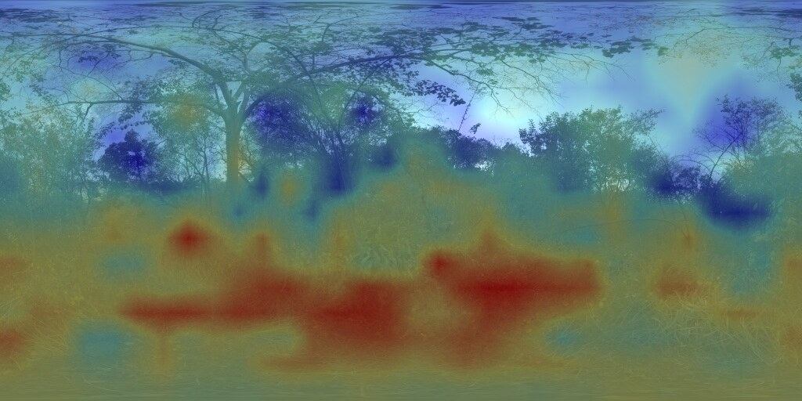
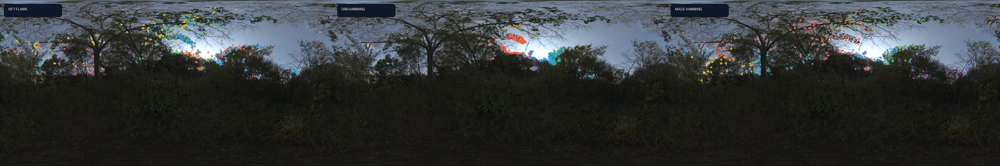

# PanorAi

[](https://pypi.org/project/panorai/)
[](https://pypi.org/project/panorai/)
[](https://github.com/rlsgarcia-code/PanorAi/actions/workflows/ci.yml)
[](https://rlsgarcia-code.github.io/PanorAi/)
[](LICENSE)

**From 360° imagery to spherical CAMs, segmentation, depth, association, and
3D reconstruction.**

PanorAi is a Python computer-vision toolkit for central spherical images. It
connects equirectangular panoramas (ERPs), perspective views, unit rays,
features, spherical CNN evidence, semantic regions, camera poses, radial depth,
and 3D structure without hiding frames, validity, scale, or provenance.

Use PanorAi to:

- project and reconstruct RGB, range, labels, and masks on one aligned grid;
- port pretrained classifiers and depth CNNs to spherical spatial operators;
- produce CAMs, segmentation candidates, matches, and region associations;
- estimate pose and radial range, then reconstruct cameras and 3D structure.

PanorAi is **not** one opaque model that turns images into a finished map. Its
stable geometry/workflow layer and its experimental perception/mapping modules
compose through explicit, inspectable contracts.



## What you can build

| Outcome | PanorAi provides | 3.7 status |
| --- | --- | --- |
| Geometry-safe 360° pipelines | ERP, gnomonic and cubemap projection; rays; multimodal validity; back-projection and fusion | **Stable / Compatibility** |
| Spherical learned evidence | native CAM/similarity maps plus adapted ImageNet, Places365, OpenCLIP, and depth frontends | **Experimental** |
| Segmentation and association | proxy-guided masks, instances, panoptic output, features, inliers, and region correspondence | **Experimental** |
| Depth and 3D reconstruction | CNN radial range, dense stereo, pose, multiview reconstruction, BA, and SLAM | **Experimental** |

## See it working

<table>
  <tr>
    <td width="50%"><br><strong>ImageNet spherical CAM</strong> · Experimental<br><sub>ResNet18 <code>lakeside</code> evidence on a native 512×1024 CC0 ERP.</sub></td>
    <td width="50%"><br><strong>Places365 scene CAM</strong> · Experimental<br><sub><code>forest/broadleaf</code> evidence from the same panorama and spherical operator path.</sub></td>
  </tr>
  <tr>
    <td width="50%"><br><strong>Cross-view association evidence</strong><br><sub>SIFT + FLANN matches across a documented longitude shift of the CC0 ERP.</sub></td>
    <td width="50%"><br><strong>Radial range result</strong> · Experimental<br><sub>Estimate, confidence, reference, and error on a deterministic analytic fixture.</sub></td>
  </tr>
  <tr>
    <td width="50%"><br><strong>Prompt-defined spherical map</strong> · Experimental<br><sub>OpenCLIP RN50 similarity for <code>a photo of a path</code>; not a segmentation mask.</sub></td>
    <td width="50%"><br><strong>Multiview 3D reconstruction</strong> · Experimental<br><sub>Contract view of cameras, bearing tracks, pose graph, triangulation, and BA.</sub></td>
  </tr>
</table>

The CAMs and feature matches use tracked CC0 imagery; the range panel uses
declared analytic geometry; the reconstruction panel is a contract diagram.
See [image provenance](docs/_static/tutorials/ATTRIBUTION.md) and the
[evidence policy](docs/evidence/index.rst). CAM colors are normalized evidence,
not calibrated probabilities or segmentation masks.

## Stability at a glance

- **Stable:** canonical geometry, modality-aware object workflow, supported
  fusion, and the face-based feature core.
- **Compatibility:** recorded 3.x imports and adapters remain available through
  the 3.x series.
- **Experimental:** sphere-native processing, direct spherical DoG, learned
  frontends, pose, depth, reconstruction, stereo, SLAM, semantics, and graph.

Experimental means public and testable, not silently promoted. Check the
[generated stability matrix](docs/reference/stability.rst) before depending on
an advanced contract.

## Install

```bash
pip install panorai==3.7.0
```

PanorAi supports Python 3.11–3.14 and OpenCV `>=4.9,<5`. Add only the
integrations you need:

```bash
pip install "panorai[torch]"                # Torch tensor workflows
pip install "panorai[deep-learning]"        # Experimental spherical FCN/CAM
pip install "panorai[deep-learning-depth]"  # Experimental Metric3D adapter
pip install "panorai[pycolmap]"             # COLMAP bridge
pip install "panorai[slam]"                 # SLAM dependencies
pip install "panorai[pcd]"                  # Point-cloud I/O
```

## First result: project one spherical view

```python
import numpy as np
from panorai.geometry import GnomonicProjector, GnomonicSpec

erp_rgb = np.zeros((512, 1024, 3), dtype=np.float32)
projector = GnomonicProjector(
    GnomonicSpec(
        center_lat_deg=10,
        center_lon_deg=30,
        hfov_deg=90,
        vfov_deg=70,
        output_shape_hw=(256, 320),
    ),
    interpolation="bilinear",
)

view = projector.project(erp_rgb)
print(view.data.shape)          # (256, 320, 3)
print(view.support_mask.shape)  # (256, 320)
```

The same projector can carry RGB, range, labels, masks, and geometric validity
through a shared grid while each modality declares its own interpolation and
invalid-data rule.

## From learned evidence to 3D results

- **CAM and similarity:** adapted classifiers return dense spherical evidence
  while preserving the exact source parameters.
- **Segmentation and association:** the proxy facade exposes mask alternatives,
  consensus/envelope masks, instances, unknown regions, and a panoptic map;
  feature/inlier evidence supports correspondence between regions.
- **Depth and reconstruction:** adapted CNNs produce radial range with validity
  and provenance; pose, stereo, triangulation, and spherical BA turn compatible
  observations into cameras and 3D structure.

These remain Experimental and keep diagnostics separate from accepted results.
Start with [spherical FCN/CAM and segmentation](docs/tutorials/09_spherical_fcn_cam.md),
[monocular depth](docs/tutorials/10_spherical_monocular_depth.md), and
[multiview reconstruction](docs/tutorials/05_multiview_reconstruction.md).

## Choose a route

| Goal | Start here |
| --- | --- |
| Convert ERP pixels, tangent views, cubemaps, and rays | [Projection foundations](docs/tutorials/02_projection_foundations.md) |
| Filter directly on the sphere or through projected views | [Spherical image processing](docs/tutorials/spherical_image_processing.md) |
| Detect and match SIFT, ORB, or AKAZE features | [Features and matching](docs/tutorials/03_features_and_matching.md) |
| Estimate relative rotation and translation direction | [Two-view geometry](docs/tutorials/04_two_view_geometry.md) |
| Estimate dense radial range from a posed pair | [Spherical dense stereo](docs/tutorials/06_spherical_dense_stereo.md) |
| Reconstruct cameras and sparse points from 3+ panoramas | [Multiview reconstruction](docs/tutorials/05_multiview_reconstruction.md) |
| Track a sequence and maintain a local map | [Spherical visual SLAM](docs/tutorials/07_spherical_slam.md) |
| Produce CAMs or proxy-guided segmentation | [Spherical FCN/CAM and segmentation](docs/tutorials/09_spherical_fcn_cam.md) |
| Estimate radial range with an adapted CNN | [Spherical monocular depth](docs/tutorials/10_spherical_monocular_depth.md) |
| Associate features and regions across views | [Features and matching](docs/tutorials/03_features_and_matching.md) · [Association API](docs/reference/object_localization.rst) |
| Inspect reproducibility and performance evidence | [Benchmarks and evidence](docs/benchmarks.rst) |

---

## 1. Projection

An ERP pixel is a sample of a ray, not a point on a flat image plane. PanorAi
uses one explicit right-handed frame (`+X` right, `+Y` up, `+Z` front) and
pixel-center convention across rays, gnomonic views, cubemaps, and arbitrary-N
overlapping face sets. Sampling declares seam and pole behavior; projection
results keep geometric support, source validity, and interpolation weight
separate.


The quickstart above is the canonical Stable route. RGB, range, labels, and
masks can share its geometric grid while choosing modality-appropriate
interpolation and invalid-data rules. Zero is data; it is never an implicit
invalid marker.

Read: [projection tutorial](docs/tutorials/02_projection_foundations.md),
[custom projection pipeline](docs/tutorials/01_custom_pipeline.md), and the
[exact geometry v1 contract](docs/geometry-v1.md).

---

## 2. Image Processing

PanorAi exposes two intentionally different routes:

```text
sphere-native: ERP ── spherical neighbourhood/filter ──► ERP

multiface:     ERP ── project ──► tangent faces ── planar operation ──►
               faces ── back-project + blend ──► ERP
```

| Property | Direct spherical route | Forward/backward multiface route |
| --- | --- | --- |
| neighbourhood | constant-angle tangent neighbourhood on the sphere | rectangular neighbourhood inside each projected face |
| seams and poles | handled by spherical sampling | handled through overlap plus blending |
| operation | spherical Gaussian/custom convolution, Sobel, Scharr, median, Canny, pyramids | any caller-owned planar operator or model through `process_views` |
| reconstruction | none | required, including a declared blender |
| best fit | filters whose geometry should remain spherical | established planar algorithms and neural networks |

The public APIs make that choice visible rather than implicit:

```text
direct = spherical_gaussian_blur(erp, ksize=5, sigma=1.2, backend="auto")

multiface = EquirectangularImage(erp).process_views(
    lambda view: cv2.GaussianBlur(view, (5, 5), 1.2),
    layout="cube", size=256, fov=95, blend="gaussian",
)
```


On the bundled CC0 panorama resized to 512×1024, a 5×5 Gaussian
(`sigma=1.2`) took **7.99 ms** after warm-up through the direct native route
and **104.25 ms** through six 256² cube faces, OpenCV filtering,
back-projection, and Gaussian blending. In a fixed 37° yaw-equivariance probe,
MAE was **0.00113** and **0.00328**, respectively. These routes are not
bit-identical operators; see the [full protocol and limitations](docs/benchmarks.rst)
and reproduce it with `scripts/benchmark_image_processing_routes.py`.

### Histogram equalization and CLAHE

`spherical_equalize_histogram` is a first-party global equalizer. Its optional
solid-angle weighting avoids over-counting the densely sampled polar rows of an
ERP. PanorAi does **not** currently claim a sphere-native CLAHE implementation.
You can apply OpenCV CLAHE to projected views through `process_views`, but the
result depends on the face layout, FOV, overlap, and blender and is not
equivalent to geodesic contextual equalization. A future spherical CLAHE needs
seam- and pole-safe contextual regions, reproducible interpolation between
regions, and evaluation on downstream feature/pose quality—not only visual
contrast.

Read: [image-processing tutorial](docs/tutorials/spherical_image_processing.md)
and [projection workflow how-to](docs/how_to/index.rst).

### Pretrained spherical FCN/CAM and proxy-guided segmentation

The opt-in `panorai.experimental.deep_learning` namespace converts AlexNet,
VGG16, and ResNet18 classification heads to fully convolutional form, replaces
their spatial convolutions and pools with differentiable spherical operators,
and reuses the exact Torchvision parameters. Checkpoints stay in external
caches; no model weights are packaged. See the [FCN/CAM tutorial](docs/tutorials/09_spherical_fcn_cam.md)
for acquisition, output-stride, map interpretation, and evidence limits.

The same Experimental family provides the InternImage-G/SAM proxy-segmentation
facade and a checksum-pinned Metric3D adapter for resize-free 2:1 ERP radial
range. Both require their documented extras and upstream terms; outputs are
model evidence, not semantic ground truth. See the [segmentation workflow](docs/tutorials/09_spherical_fcn_cam.md#12-one-object-proxy-guided-segmentation-workflow)
and [monocular-depth tutorial](docs/tutorials/10_spherical_monocular_depth.md).

---

## 3. Detection and Feature Extraction

PanorAi separates *where a keypoint is detected* from *how its local appearance
is described*.

| Frontend | Detection | Description | Status |
| --- | --- | --- | --- |
| overlapping faces | OpenCV SIFT, ORB, or AKAZE on gnomonic faces | same OpenCV backend | Stable core |
| spherical DoG | Gaussian/DoG extrema directly on the sphere | one oriented tangent patch per accepted keypoint, then OpenCV SIFT/ORB/AKAZE | Experimental |
| coarse-to-fine spherical DoG | low-resolution proposals followed by full-resolution localization | descriptor-neutral tangent-patch adapter | Experimental |

For relative pose, `SphericalFeaturePipeline.for_relative_pose()` remains the
canonical validated default. Direct spherical DoG is an explicit opt-in while
its public-dataset detection, matching, and pose evaluation is completed.



The spherical detector avoids overlap duplicates and carries position, bearing,
angular scale, response, octave, orientation, and localization validity into a
descriptor-neutral tangent-patch contract. OpenCV still owns SIFT/ORB/AKAZE
descriptor and matcher semantics; optional native kernels accelerate spherical
geometry without changing its reference result.


Read: [features and matching](docs/tutorials/03_features_and_matching.md),
[spherical feature how-to](docs/how_to/spherical_features.rst), and
[feature API](docs/reference/features.rst).

---

## 4. Two-View Geometry

PanorAi can estimate a relative pose directly from matched unit bearings—no
COLMAP process is involved:

```text
ERP pair → features → descriptor matches → bearing pairs
         → 5-point Essential hypotheses → spherical MSAC/refit
         → cheirality + degeneracy/quality gates → R₂₁, direction(t₂₁)
```


The estimator scores tangent-Sampson residuals on the sphere, evaluates the
four Essential decompositions, selects translation orientation using
cheirality/parallax evidence, optionally refines rotation and translation
direction, and reports rejection reasons. A returned hypothesis is not
automatically a trustworthy pose: consume `quality_report.accepted`.

Monocular two-view geometry recovers the **direction** of translation, not its
metric magnitude. Metric scale needs an external premise such as a known
baseline, calibrated rig, depth, or a justified scene constraint.

Read: [two-view geometry](docs/tutorials/04_two_view_geometry.md) and the
[public-dataset benchmark](docs/benchmarks.rst).

---

## 5. Stereo Dense Reconstruction

Given two aligned central ERPs and a **known metric** relative pose, the
Experimental stereo route searches inverse radial range directly along
spherical epipolar geometry. It uses angular appearance support, optional
coarse-to-fine search, cost aggregation, sub-hypothesis refinement, and
bidirectional consistency.


The result keeps radial range, confidence, validity, selected cost, and
consistency diagnostics separate. The supplied `R,t` is never silently
re-estimated. If `t` has arbitrary unit length, the reconstructed range has the
same arbitrary scale.

Read: [dense-stereo tutorial](docs/tutorials/06_spherical_dense_stereo.md),
[algorithm derivation](docs/explanation/spherical_dense_stereo.md), and
[current evidence](docs/benchmarks.rst).

## 6. Multi-View Geometry

For three or more panoramas, PanorAi offers two routes:

| Route | PanorAi owns | External owner |
| --- | --- | --- |
| native `SphericalGlobalMapper` | quality-gated pose graph, bearing tracks, rotation/position initialization, triangulation, spherical bundle adjustment, diagnostics | none for geometry |
| PyCOLMAP/COLMAP bridge | virtual-camera geometry, IDs, observations, and database/export contract | PyCOLMAP/COLMAP mapping and optimization |


The native mapper optimizes angular tangent residuals without reconstructing
ERP pixels during bundle adjustment. Its map is arbitrary-scale unless a metric
prior is supplied. The PyCOLMAP route is useful when COLMAP interoperability is
more important than keeping spherical equations first-party; it is an
alternative pipeline, not a hidden dependency of the native mapper.

For registered metric cameras, Experimental metric landmark BA refines supplied
spherical landmarks with a baseline gauge and soft radial-range priors. It
reports sparse landmark support explicitly and does not produce a dense depth map.
Read: [multiview reconstruction](docs/tutorials/05_multiview_reconstruction.md) and [public-dataset benchmark](docs/benchmarks.rst).

---

## Other essential capabilities

The six sections above cover the offline core. Two additional areas should not
be forgotten:

- **Visual SLAM:** incremental ERP or calibrated fisheye tracking,
  keyframes, local mapping, relocalization, and loop correction. Start with the
  [SLAM tutorial](docs/tutorials/07_spherical_slam.md).
- **Contracts and reproducibility:** coordinate frames, units, pixel centers,
  interpolation, invalid-data rules, resolved configuration, provenance, and
  quality gates are part of the result—not incidental metadata. Read the
  [geometry contract](docs/geometry-v1.md), [stability tiers](docs/reference/stability.rst),
  and [benchmark policy](docs/benchmarks.rst).

## Evidence and project boundaries

The [benchmarks and performance page](docs/benchmarks.rst) separates
microbenchmarks from end-to-end accuracy, reports Matterport3D and
Stanford2D3D independently, and distinguishes accepted-result precision from
coverage. Dataset licenses apply; PanorAi does not redistribute those datasets.

PanorAi owns spherical coordinates, projection, masks, provenance, spherical
image-processing kernels, bearing geometry, and its native estimators. OpenCV
owns SIFT/ORB/AKAZE descriptors and standard matchers; optional PyCOLMAP/COLMAP
owns its downstream reconstruction route. See the
[capability map](docs/tutorials/spherical_capability_map.md) for the complete
sphere-native, projection-domain, and hybrid boundary.

## Reference

- [Documentation home](docs/index.rst)
- [Tutorials in workflow order](docs/tutorials/index.rst)
- [API reference](docs/reference/index.rst)
- [Changelog](CHANGELOG.md)
- [License](LICENSE)

PanorAi's distributed source is MIT licensed. Optional upstream projects,
models, and datasets retain their own terms.
