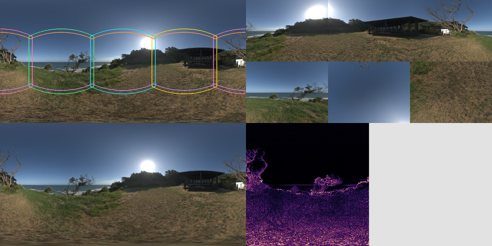
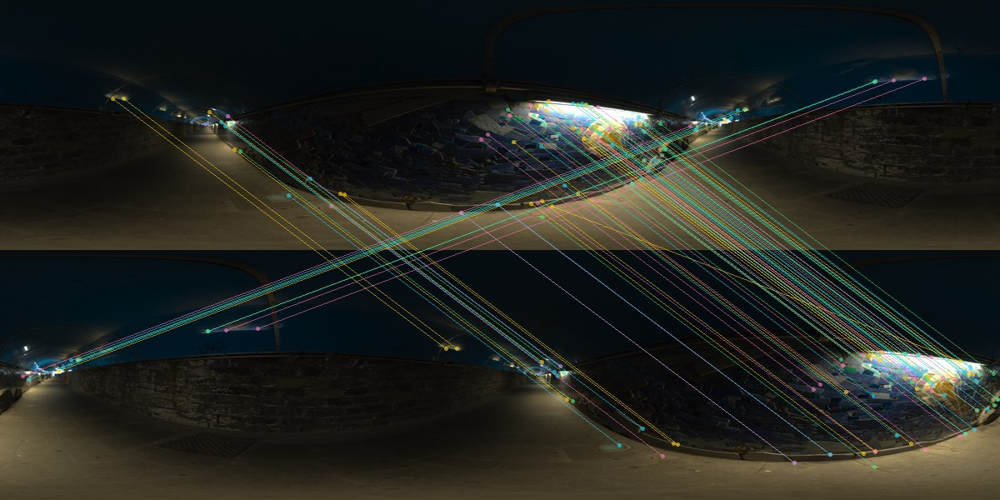
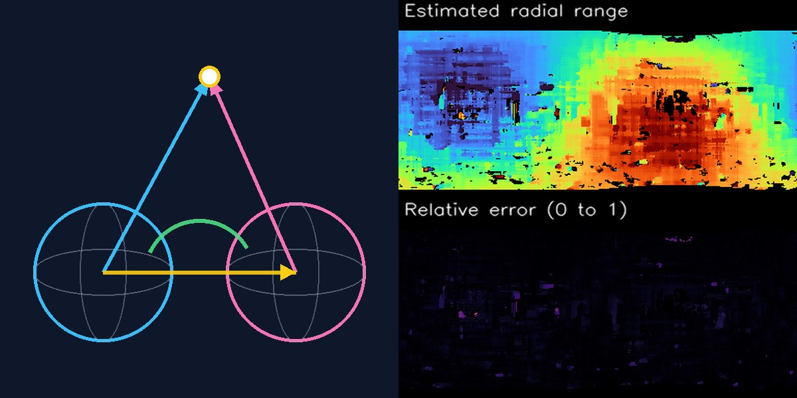
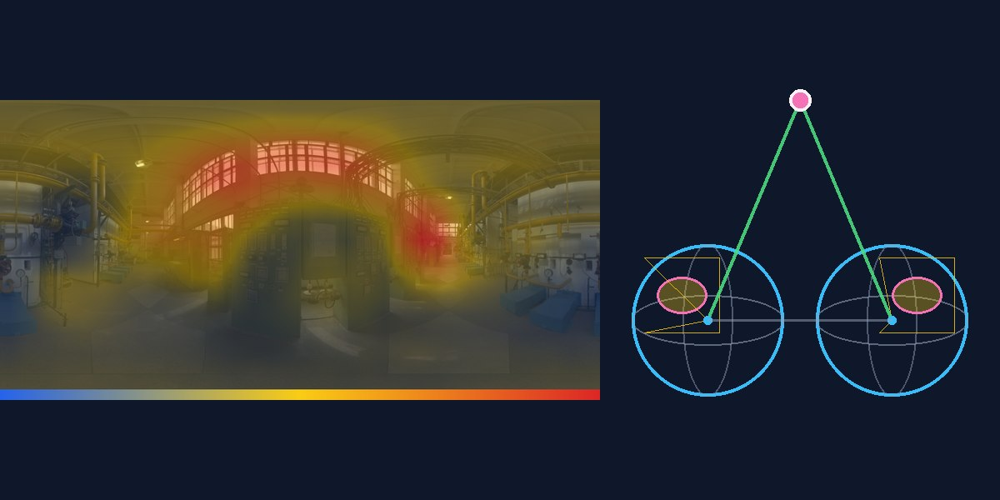
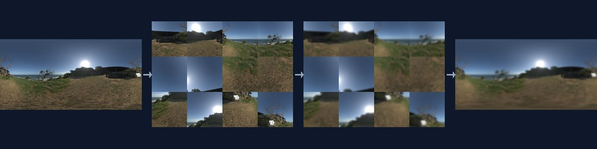
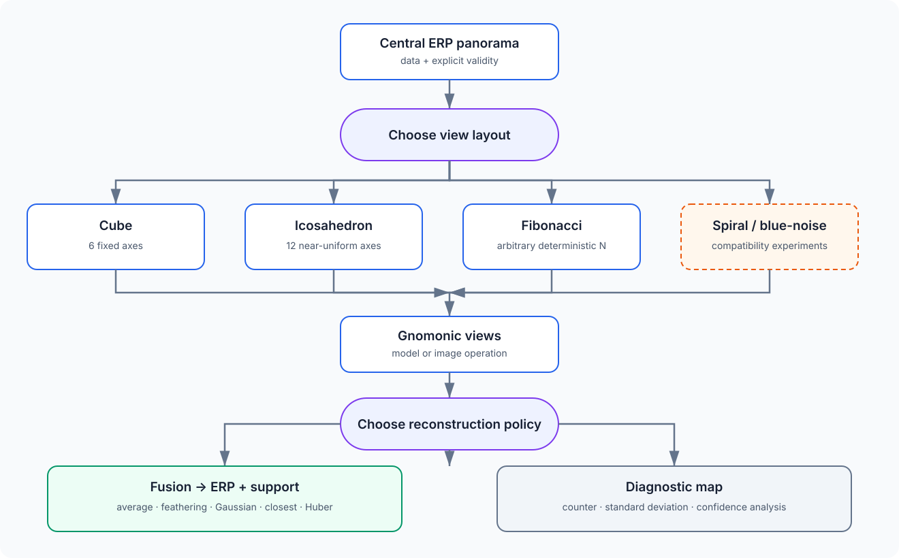
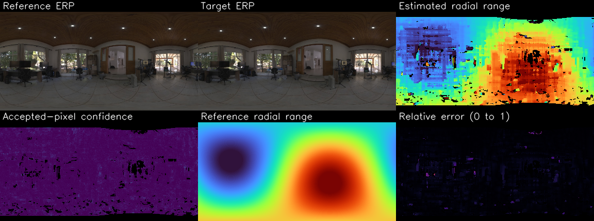
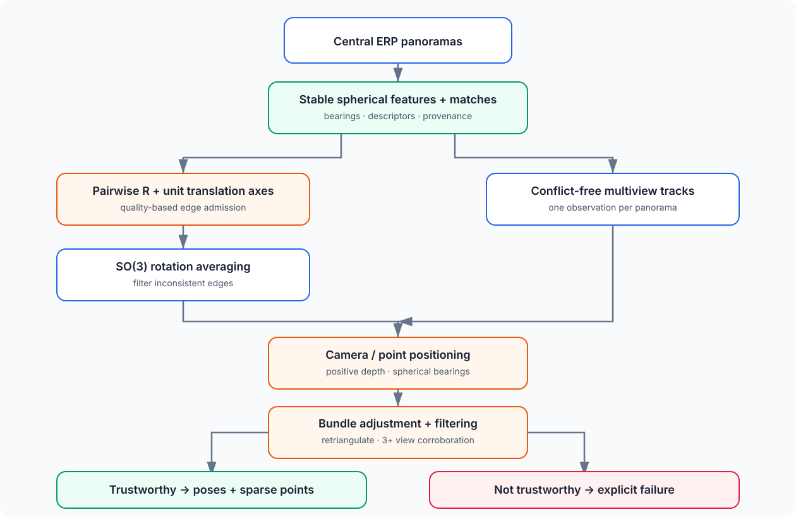

# PanorAi

[](https://pypi.org/project/panorai/)
[](https://pypi.org/project/panorai/)
[](https://github.com/rlsgarcia-code/PanorAi/actions/workflows/ci.yml)
[](https://rlsgarcia-code.github.io/PanorAi/)
[](LICENSE)

**Geometry-safe spherical image processing and projection for computer-vision
applications.**

PanorAi lets computer-vision methods consume 360° images: reuse a pinhole
method over sampled views, or build directly with sphere-native operations.

## Install

```bash
pip install panorai==3.7.0
```

NumPy is required. Add `panorai[torch]`, `panorai[deep-learning]`,
`panorai[pycolmap]`, `panorai[slam]`, or `panorai[pcd]` only for the
corresponding optional application.

## Build computer vision with spherical images

| Process and project | Extract and match features |
| --- | --- |
| [](https://rlsgarcia-code.github.io/PanorAi/tutorials/02_projection_foundations.html) | [](https://rlsgarcia-code.github.io/PanorAi/tutorials/03_features_and_matching.html) |
| **Estimate pose and radial range** | **Localize semantic regions** |
| [](https://rlsgarcia-code.github.io/PanorAi/tutorials/04_two_view_geometry.html) | [](https://rlsgarcia-code.github.io/PanorAi/tutorials/09_spherical_fcn_cam.html) |

PanorAi offers two paths.

## 1. Apply a pinhole method over the sphere

Sample overlapping views, run the existing function on each face, then fuse
the result back into an ERP:

```python
import cv2
import numpy as np
from panorai import EquirectangularImage

rgb = np.zeros((64, 128, 3), dtype=np.uint8)
panorama = EquirectangularImage(rgb)
views = panorama.views("icosahedron", size=64, fov=100)
processed = views.map(lambda face: cv2.GaussianBlur(face, (5, 5), 1.0))
result = processed.reconstruct(blend="gaussian")
```



Left to right: the source ERP, 12 real gnomonic views, the same views after an
OpenCV blur, and the Gaussian-blended spherical result.



The same workflow supports filters, detectors, segmentation and monocular
depth. Raster outputs are reconstructed; points, boxes and embeddings are
lifted with `map_points`, `map_regions` and `map_views`.
[Choose a sampler and fusion method →](https://rlsgarcia-code.github.io/PanorAi/reference/samplers_blenders.html)

## 2. Operate directly on the sphere

Sphere-native layers use tangent neighbourhoods without creating or fusing
faces:

```python
from panorai.core.numpy import SphericalConv2d

weight = np.ones((1, 1, 3, 3), dtype=np.float32) / 9
conv = SphericalConv2d(weight, padding=1)
filtered = conv(rgb.mean(axis=-1, dtype=np.float32)[None, None])
```

The Torch layers compose like ordinary `nn.Module` objects and preserve
autograd:

```python
import torch
from torch import nn
from panorai.core.torch import SphericalConv2d, SphericalMaxPool2d

model = nn.Sequential(
    SphericalConv2d(in_channels=3, out_channels=16, kernel_size=3, padding=1),
    nn.ReLU(),
    SphericalMaxPool2d(kernel_size=2),
)
features = model(torch.rand(1, 3, 32, 64))
```

This enables direct spherical filters, trainable CNNs, dense CAMs, depth and
segmentation models. `port_module(pretrained_model)` replaces supported planar
spatial layers while preserving their learned parameters; the model-specific
adapter still owns input normalization and classifier-head conversion.

| Sphere-native case | Focused example |
| --- | --- |
| Convolution, Gaussian blur, gradients and edges | [Direct spherical image processing](https://rlsgarcia-code.github.io/PanorAi/tutorials/spherical_image_processing.html) |
| Compose trainable layers | [Build a spherical model](https://rlsgarcia-code.github.io/PanorAi/tutorials/12_composing_spherical_models.html) |
| Detect and describe features | [Sphere-native feature extraction](https://rlsgarcia-code.github.io/PanorAi/applications/features_matching/sphere_native_features.html) |
| Convert a pretrained classification CNN and generate CAMs | [Spherical classification and CAM](https://rlsgarcia-code.github.io/PanorAi/applications/semantic_regions/spherical_cam.html) |
| Convert a pretrained depth CNN | [Sphere-native Metric3D](https://rlsgarcia-code.github.io/PanorAi/applications/pose_range/metric3d_sphere_native.html) |

## Ready-made applications

| Features and matching | Pose and reconstruction |
| --- | --- |
| [](https://rlsgarcia-code.github.io/PanorAi/tutorials/03_features_and_matching.html)<br>`SphericalFeaturePipeline` | [](https://rlsgarcia-code.github.io/PanorAi/tutorials/04_two_view_geometry.html)<br>`SphericalRelativePoseEstimator` · `SphericalGlobalMapper` |
| **Spherical stereo** | **Monocular depth** |
| [](https://rlsgarcia-code.github.io/PanorAi/tutorials/06_spherical_dense_stereo.html)<br>`SphericalDenseStereo` · analytic fixture | [](https://rlsgarcia-code.github.io/PanorAi/tutorials/10_spherical_monocular_depth.html)<br>`SphericalMetric3D` |
| **SLAM** | **CAM and semantic localization** |
| [](https://rlsgarcia-code.github.io/PanorAi/tutorials/07_spherical_slam.html)<br>`SphericalVisualSLAM` · `SphericalIncrementalSLAM` · method diagram | [](https://rlsgarcia-code.github.io/PanorAi/tutorials/09_spherical_fcn_cam.html)<br>`SphericalSemanticSegmenter` · `SphericalObjectHypothesisMethod` |

## Contracts that apply everywhere

- Coordinates are pixel-centre based, top-left origin, `+X` right, `+Y` up,
  `+Z` forward, longitude `[-π, π)`, and north-to-south latitude.
- Depth means radial range unless an API explicitly names another quantity.
- Geometric support, numerical validity and value are distinct. Zero is data;
  it is never an implicit invalid marker.
- Labels and masks require nearest-neighbour sampling. Bilinear interpolation
  of integer or boolean data fails explicitly.
- NumPy is required; Torch, Open3D, PyCOLMAP, learned checkpoints and datasets
  are optional and are not imported by the geometry core.
- Check the [stability matrix](https://rlsgarcia-code.github.io/PanorAi/reference/stability.html) before depending
  on an Experimental wrapper.

## Reference

- [Core operations](https://rlsgarcia-code.github.io/PanorAi/how_to/spherical_image_processing.html)
- [Geometry v1](https://rlsgarcia-code.github.io/PanorAi/geometry-v1.html)
- [Typed fields and spherical workflows](https://rlsgarcia-code.github.io/PanorAi/tutorials/01_custom_pipeline.html)
- [Sampling and fusion](https://rlsgarcia-code.github.io/PanorAi/reference/samplers_blenders.html)
- [Tutorials by application](https://rlsgarcia-code.github.io/PanorAi/tutorials/index.html)
- [Execution strategies](https://rlsgarcia-code.github.io/PanorAi/tutorials/spherical_capability_map.html)
- [Evidence and benchmarks](https://rlsgarcia-code.github.io/PanorAi/benchmarks.html)
- [Changelog](CHANGELOG.md)
- [License](LICENSE)
