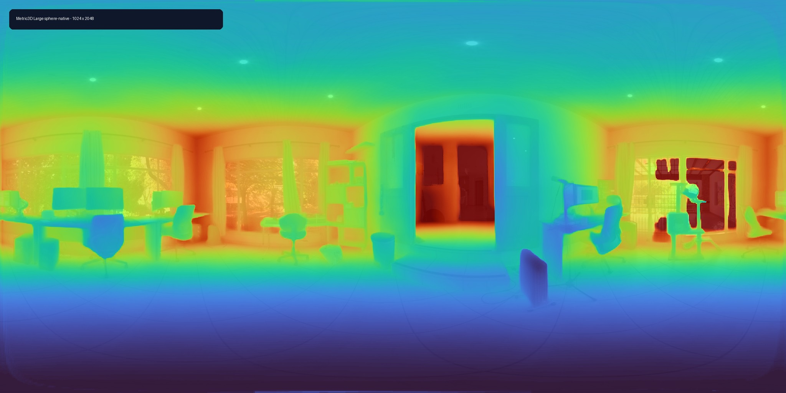
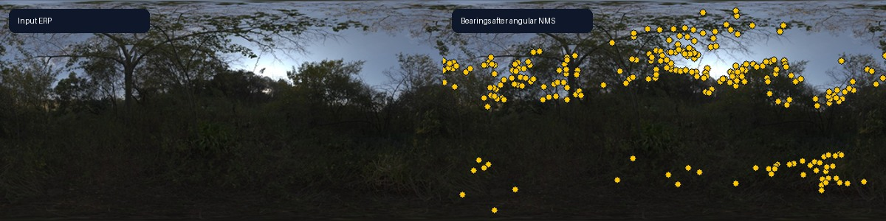
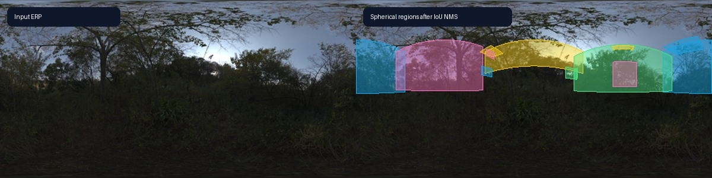
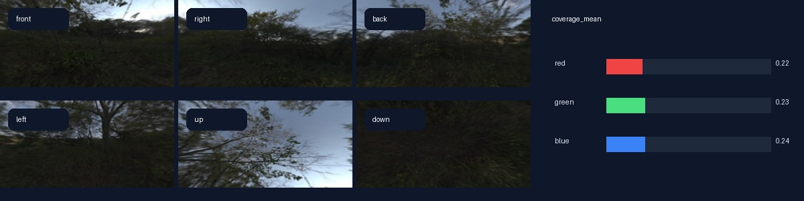

# PanorAi

[](https://pypi.org/project/panorai/)
[](https://pypi.org/project/panorai/)
[](https://github.com/rlsgarcia-code/PanorAi/actions/workflows/ci.yml)
[](https://rlsgarcia-code.github.io/PanorAi/)
[](LICENSE)

**Build computer-vision methods for spherical images.** Use an unchanged
pinhole method on sampled views and fuse its outputs, or compose operations
that work directly on the ERP sphere.

```bash
pip install panorai==3.7.0
```

NumPy is required. Torch is optional: `pip install "panorai[torch]"`.

## The three objects

| Object | Meaning |
| --- | --- |
| `EquirectangularImage` | Complete spherical raster with typed fields. |
| `GnomonicFace` | One pinhole view with projection, support and validity. |
| `GnomonicFaceSet` | Views processed, lifted or fused together. |

## 1. Apply pinhole methods over the sphere

### Start with one operation

```python
import cv2
import numpy as np
from panorai import EquirectangularImage

rgb = np.zeros((64, 128, 3), dtype=np.uint8)
panorama = EquirectangularImage(rgb)

views = panorama.views("icosahedron", size=64, fov=100)
blurred_views = views.map(lambda image: cv2.GaussianBlur(image, (5, 5), 1.0))
result = blurred_views.reconstruct(blend="gaussian")
```


Sampling chooses view centres, resolution, FOV and overlap. Every processed
pixel is back-projected through `face.spec`; fusion uses only supported, valid
contributors. Use `average` or `gaussian` for continuous fields and `closest`
for labels and masks.
[Compare sampling and fusion →](https://rlsgarcia-code.github.io/PanorAi/reference/samplers_blenders.html)

### Combine pinhole operations: Canny

`process_views()` is the short form of sample → process → fuse:

```python
def canny(image):
    gray = cv2.cvtColor(image.astype(np.uint8), cv2.COLOR_RGB2GRAY)
    smooth = cv2.GaussianBlur(gray, (5, 5), 1.0)
    return cv2.Canny(smooth, 40, 120)

edges = panorama.process_views(
    canny, layout="cube", size=64, fov=100, blend="closest"
)
```


### Run a pretrained pinhole model: Depth Anything

Depth Anything remains a planar model. PanorAi owns its tangent cameras,
axial-to-radial conversion, masks and fusion:

```python
from panorai.experimental.deep_learning import load_da3metric_large

views = panorama.views(
    "icosahedron", subdivisions=1, size=(812, 1400), fov=(100.0, 80.0)
)
loaded = load_da3metric_large(
    accept_upstream_terms=True, cache_dir=model_cache, device="cpu"
)
depth_views = views.map(
    loaded.tangent(views[0].spec), input="image", output="depth", units="m"
)
radial_range = depth_views.reconstruct(
    modalities="depth", blend={"depth": "gaussian"}
)
```


[Depth Anything view workflow →](https://rlsgarcia-code.github.io/PanorAi/applications/pose_range/depth_anything_views.html)

## 2. Operate directly on the sphere

### One native operation: gradient

The output is already an ERP. There are no transient views or fusion:

```python
from panorai.core.numpy import SphericalGradient

gray = rgb.mean(axis=-1, dtype=np.float32)[None, None] / 255.0
components = SphericalGradient(operator="scharr")(gray)
magnitude = np.hypot(components[:, 0::2], components[:, 1::2])
```


| 256×512 gradient route | Median time | Yaw MAE |
| --- | ---: | ---: |
| Native C++ spherical Scharr | 1.89–1.91 ms | 0.00405 |
| Cube → OpenCV → fusion | 22.61–27.71 ms | 0.00515 |

Two macOS arm64 trials, 15 reused calls each; not a universal ranking.
[Method and reproduction command →](https://rlsgarcia-code.github.io/PanorAi/benchmarks.html#image-processing-routes)

### Compose operations: a DoG pyramid

```python
from panorai.core.numpy import SphericalGaussianBlur2d, SphericalResize

small = SphericalGaussianBlur2d(sigma=1.0)
large = SphericalGaussianBlur2d(sigma=2.0)

smooth_0 = small(gray)
dog_0 = large(gray) - smooth_0
octave_1 = SphericalResize(scale_factor=0.5)(smooth_0)
dog_1 = large(octave_1) - small(octave_1)
```


`dog_1` has half the height and width of `dog_0`. The same NumPy/C++ and Torch
core provides convolution, `SphericalResize`, `SphericalMaxPool2d`, gradients
and reductions.
[Core operations →](https://rlsgarcia-code.github.io/PanorAi/reference/core_operations.html)

### Convert pretrained CNNs

Experimental adapters retain convolution weights while replacing spatial
layers (`Conv2d → SphericalConv2d`) with spherical equivalents. Metric3D uses
63 `SphericalConv2d`
convolutions plus three DC-normalized spherical resize-convolution upsamplers,
avoiding stride-period bands from stacked learned deconvolutions:

```python
import torch
from panorai.experimental.deep_learning import load_spherical_metric3d_convnext_large_v1

metric3d = load_spherical_metric3d_convnext_large_v1(
    accept_upstream_terms=True, cache_dir=model_cache, device="cpu"
)
values = torch.from_numpy(rgb.astype(np.float32)).permute(2, 0, 1)[None]
radial_range_m = metric3d.model(values)
```

`radial_range_m` is a `1×1×H×W` radial-range ERP. This real run used a public
CC0 `1024×2048` ERP and returned the same lattice without faces or hidden resize:



| Native 1024×2048 CPU run | Median | P95 | Peak RSS |
| --- | ---: | ---: | ---: |
| Metric3D Large spherical CNN | 41.91 s | 42.30 s | 4.17 GB |

The 2K run used three measured calls after warm-up. In the controlled `256×512`
route comparison, direct spherical inference took `1.91 s` versus `7.66 s` for
six faces plus fusion. These are execution results, not accuracy claims. The
checkpoint and raw prediction are not redistributed.
[Metric3D method →](https://rlsgarcia-code.github.io/PanorAi/tutorials/10_spherical_monocular_depth.html)

The same conversion turns ResNet18 into a dense ImageNet CAM generator:

```python
from panorai.core.torch import port_module_with_report
from panorai.experimental.deep_learning import (
    ImageNetFCN, class_activation_map, load_pretrained_imagenet_model,
)

loaded = load_pretrained_imagenet_model("resnet18")
fcn = ImageNetFCN(loaded.model, "resnet18").eval()
port_module_with_report(fcn)
dense = fcn.forward_dense(normalized_erp).logits
cam = class_activation_map(dense, class_index=975, output_shape=rgb.shape[:2])
```


[ImageNet CAM method →](https://rlsgarcia-code.github.io/PanorAi/tutorials/09_spherical_fcn_cam.html)

### Segment directly with spherical SLIC

SLIC can also create superpixels directly on the ERP. Its spatial term is the
intrinsic great-circle distance between sphere rays—not pixel distance inside
a gnomonic projection:

```python
from panorai.image_processing import spherical_slic

labels = spherical_slic(
    rgb,
    n_segments=256,
    compactness=10.0,
    max_num_iter=10,
    start_label=1,
)
```

`labels` is an `H×W` integer ERP with connectivity across the longitude seam.
[Spherical SLIC method →](https://rlsgarcia-code.github.io/PanorAi/how_to/spherical_image_processing.html#spherical-slic-superpixels)

## 3. Return the right spherical output

### Dense rasters

```python
from panorai.data import RasterFieldSpec

logit_views = views.map(
    predict_logits,
    output="logits",
    spec=RasterFieldSpec.continuous(component_ids=class_names),
)
logits_erp = logit_views.reconstruct(modalities="logits", blend="gaussian")
```

Every channel is reprojected and fused at each supported ERP pixel. The same
path carries RGB, depth, labels, CAMs and dense embeddings.


### Points

```python
points = views.map_points(detect_points, source_id="detector")
points = points.angular_nms(max_angle_deg=0.25).observations
```

Face pixels become unit bearings; angular NMS removes overlap duplicates.



### Regions

```python
regions = views.map_regions(detect_regions, source_id="detector")
regions = regions.nms(iou_threshold=0.5).observations
```

Boxes, polygons and masks become spherical supports compared with solid-angle
IoU rather than ERP pixel area.



### Whole-view evidence

```python
evidence = views.map_views(classify_or_embed, source_id="encoder")
global_evidence = evidence.aggregate("coverage_mean")
```

Scores and embeddings retain each view footprint. Coverage-aware aggregation
prevents overlap from counting the same direction more than once.



| Face result | Return path | Spherical result |
| --- | --- | --- |
| Dense image, depth, labels, logits or embeddings | `map()` + `reconstruct()` | `EquirectangularImage` |
| Keypoints or point detections | `map_points()` + angular NMS | `SphericalPointSet` |
| Boxes, polygons or masks | `map_regions()` + solid-angle NMS | `SphericalRegionSet` |
| Whole-view scores or embeddings | `map_views()` + aggregation | `SphericalViewSet` |

For ready-made feature extraction and matching, use `SphericalFeaturePipeline`;
the typed point path above is the lower-level composition surface.
[Typed outputs and examples →](https://rlsgarcia-code.github.io/PanorAi/explanation/workflow-evolution.html)

## Go deeper

- [Quick start](https://rlsgarcia-code.github.io/PanorAi/tutorials/00_quick_start.html)
- [Geometry contract](https://rlsgarcia-code.github.io/PanorAi/geometry-v1.html)
- [Stability matrix](https://rlsgarcia-code.github.io/PanorAi/reference/stability.html)
- [Changelog](CHANGELOG.md) · [License](LICENSE)
