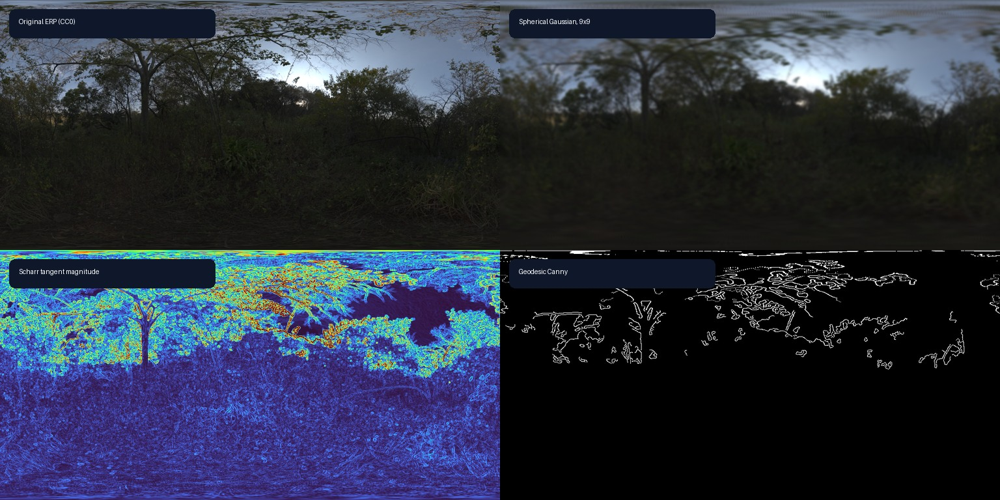
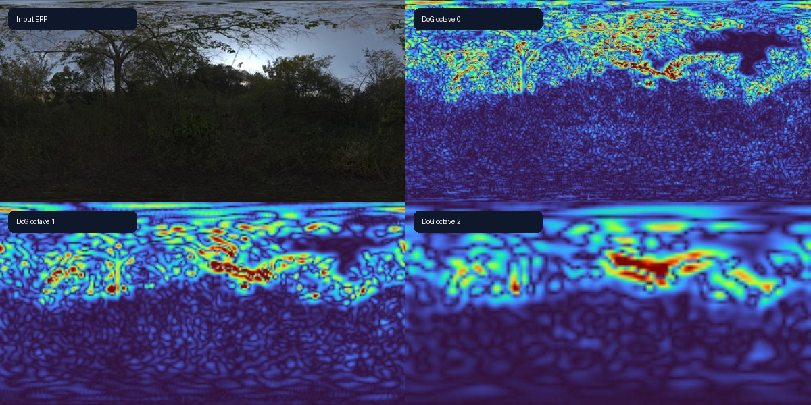
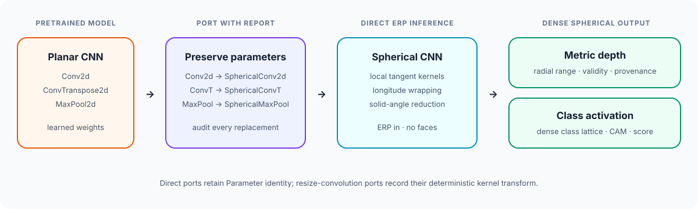

# PanorAi

[](https://pypi.org/project/panorai/)
[](https://pypi.org/project/panorai/)
[](https://github.com/rlsgarcia-code/PanorAi/actions/workflows/ci.yml)
[](https://rlsgarcia-code.github.io/PanorAi/)
[](LICENSE)

**Build computer-vision methods for spherical images.** Use an unchanged
pinhole method on sampled views and fuse its outputs, or compose operations
that work directly on the ERP sphere.

```bash
pip install panorai==3.7.0
```

NumPy is required. Torch is optional: `pip install "panorai[torch]"`.

## The three objects

| Object | Meaning |
| --- | --- |
| `EquirectangularImage` | Complete spherical raster with typed fields. |
| `GnomonicFace` | One pinhole view with projection, support and validity. |
| `GnomonicFaceSet` | Views processed, lifted or fused together. |

## 1. Apply pinhole methods over the sphere

### Start with one operation

```python
import cv2
import numpy as np
from panorai import EquirectangularImage

rgb = np.zeros((64, 128, 3), dtype=np.uint8)
panorama = EquirectangularImage(rgb)

views = panorama.views("icosahedron", size=64, fov=100)
blurred_views = views.map(lambda image: cv2.GaussianBlur(image, (5, 5), 1.0))
result = blurred_views.reconstruct(blend="gaussian")
```


Sampling chooses view centres, resolution, FOV and overlap. Every processed
pixel is back-projected through `face.spec`; fusion uses only supported, valid
contributors. Use `average` or `gaussian` for continuous fields and `closest`
for labels and masks.
[Compare sampling and fusion →](https://rlsgarcia-code.github.io/PanorAi/reference/samplers_blenders.html)

### Combine pinhole operations: Canny

`process_views()` is the short form of sample → process → fuse:

```python
def canny(image):
    gray = cv2.cvtColor(image.astype(np.uint8), cv2.COLOR_RGB2GRAY)
    smooth = cv2.GaussianBlur(gray, (5, 5), 1.0)
    return cv2.Canny(smooth, 40, 120)

edges = panorama.process_views(
    canny, layout="cube", size=64, fov=100, blend="closest"
)
```

### Run a pretrained pinhole model: Depth Anything

Depth Anything remains a planar model. PanorAi owns its tangent cameras,
axial-to-radial conversion, masks and fusion:

```python
from panorai.experimental.deep_learning import load_da3metric_large

views = panorama.views(
    "icosahedron", subdivisions=1, size=(812, 1400), fov=(100.0, 80.0)
)
loaded = load_da3metric_large(
    accept_upstream_terms=True, cache_dir=model_cache, device="cpu"
)
depth_views = views.map(
    loaded.tangent(views[0].spec), input="image", output="depth", units="m"
)
radial_range = depth_views.reconstruct(
    modalities="depth", blend={"depth": "gaussian"}
)
```

[Depth Anything view workflow →](https://rlsgarcia-code.github.io/PanorAi/applications/pose_range/depth_anything_views.html)

## 2. Operate directly on the sphere

### One native operation: gradient

The output is already an ERP. There are no transient views or fusion:

```python
from panorai.core.numpy import SphericalGradient

gray = rgb.mean(axis=-1, dtype=np.float32)[None, None] / 255.0
components = SphericalGradient(operator="scharr")(gray)
magnitude = np.hypot(components[:, 0::2], components[:, 1::2])
```



Two macOS arm64 trials at 256×512 (15 reused calls each) measured native C++
Scharr at **1.89–1.91 ms** versus **22.61–27.71 ms** for cube → OpenCV Scharr
→ fusion (**11.9–14.5×**). The 37° yaw-equivariance MAE was **0.00405** versus
**0.00515**. This is one public image and configuration, not a universal claim.
[Method and reproduction command →](https://rlsgarcia-code.github.io/PanorAi/benchmarks.html#image-processing-routes)

### Compose operations: a DoG pyramid

```python
from panorai.core.numpy import SphericalGaussianBlur2d, SphericalResize

small = SphericalGaussianBlur2d(sigma=1.0)
large = SphericalGaussianBlur2d(sigma=2.0)

smooth_0 = small(gray)
dog_0 = large(gray) - smooth_0
octave_1 = SphericalResize(scale_factor=0.5)(smooth_0)
dog_1 = large(octave_1) - small(octave_1)
```



`dog_1` has half the height and width of `dog_0`. The same NumPy/C++ and Torch
core provides convolution, resize, pooling, gradients and reductions.
[Core operations →](https://rlsgarcia-code.github.io/PanorAi/reference/core_operations.html)

### Convert pretrained CNNs



Experimental adapters preserve learned weights and replace spatial layers:
`Conv2d → SphericalConv2d`, `ConvTranspose2d → SphericalConvTranspose2d`, and
`MaxPool2d → SphericalMaxPool2d`. The converted CNN consumes the ERP directly.

- [Metric3D CNN → radial range](https://rlsgarcia-code.github.io/PanorAi/tutorials/10_spherical_monocular_depth.html)
- [ImageNet CNN → dense CAM](https://rlsgarcia-code.github.io/PanorAi/tutorials/09_spherical_fcn_cam.html)

## 3. Return the right spherical output

The callback output selects the spherical return path:

```python
from panorai.data import RasterFieldSpec

# Dense C-channel logits/CAM: preserve every channel, then fuse each pixel.
logit_views = views.map(
    predict_logits,
    output="logits",
    spec=RasterFieldSpec.continuous(component_ids=class_names),
)
logits_erp = logit_views.reconstruct(modalities="logits", blend="gaussian")

# Point detections/features: pixels become bearings; overlap duplicates vanish.
points = views.map_points(detect_points, source_id="detector")
points = points.angular_nms(max_angle_deg=0.25).observations

# Boxes, polygons or masks: lift footprints and compare solid-angle overlap.
regions = views.map_regions(detect_regions, source_id="detector")
regions = regions.nms(iou_threshold=0.5).observations

# One score vector or embedding per view: aggregate without counting overlap twice.
evidence = views.map_views(classify_or_embed, source_id="encoder")
global_evidence = evidence.aggregate("coverage_mean")
```

| Face result | Return path | Spherical result |
| --- | --- | --- |
| Dense image, depth, labels, logits or embeddings | `map()` + `reconstruct()` | `EquirectangularImage` |
| Keypoints or point detections | `map_points()` + angular NMS | `SphericalPointSet` |
| Boxes, polygons or masks | `map_regions()` + solid-angle NMS | `SphericalRegionSet` |
| Whole-view scores or embeddings | `map_views()` + aggregation | `SphericalViewSet` |

For ready-made feature extraction and matching, use `SphericalFeaturePipeline`;
the typed point path above is the lower-level composition surface.
[Typed outputs and examples →](https://rlsgarcia-code.github.io/PanorAi/explanation/workflow-evolution.html)

## Go deeper

- [Quick start](https://rlsgarcia-code.github.io/PanorAi/tutorials/00_quick_start.html)
- [Geometry contract](https://rlsgarcia-code.github.io/PanorAi/geometry-v1.html)
- [Stability matrix](https://rlsgarcia-code.github.io/PanorAi/reference/stability.html)
- [Changelog](CHANGELOG.md) · [License](LICENSE)
