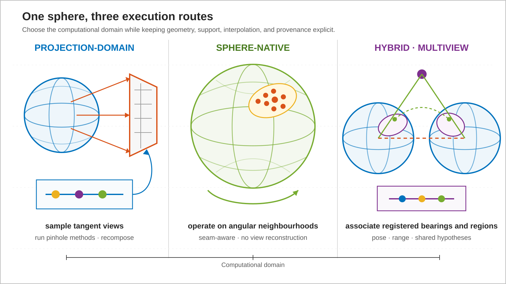
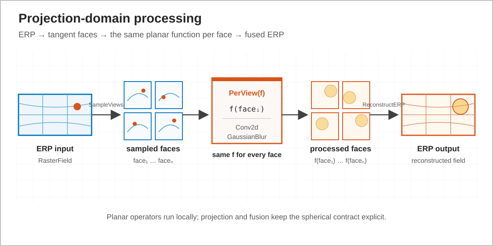
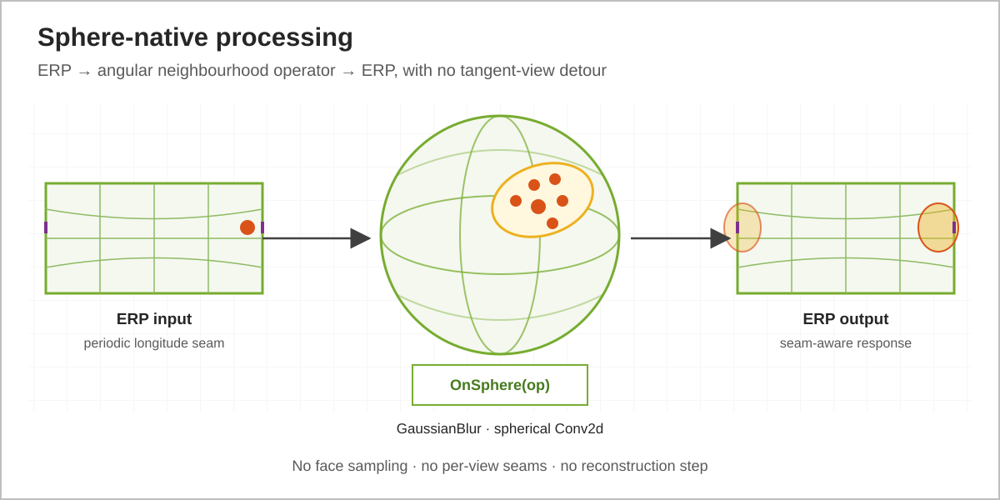
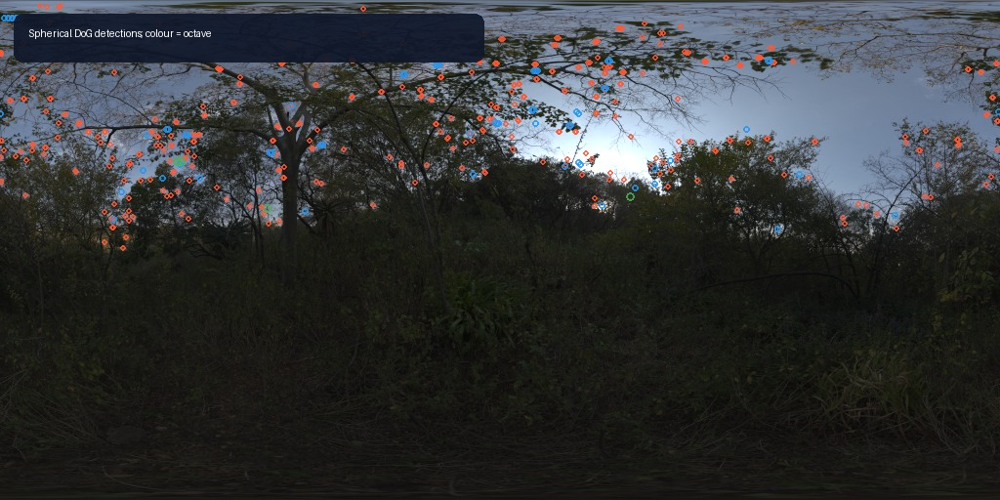
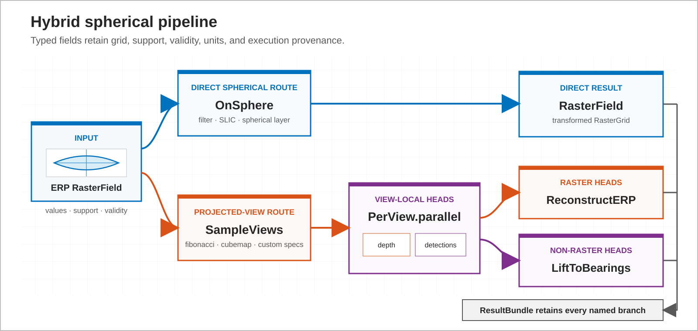

# PanorAi

[](https://pypi.org/project/panorai/)
[](https://pypi.org/project/panorai/)
[](https://github.com/rlsgarcia-code/PanorAi/actions/workflows/ci.yml)
[](https://rlsgarcia-code.github.io/PanorAi/)
[](LICENSE)

**Spherical image processing and projection with explicit geometry, support,
validity and units.** Use ready-made applications, compose a pipeline, call
sphere-native operations, or keep using the Stable object workflow directly.



PanorAi is a fit when a planar image API is not enough: you need explicit ERP-to-view projection, seam-aware spherical operations,
typed multiview fusion, or radial-range geometry. It is a library—not a dataset, training framework, checkpoint collection, or hidden-geometry model runner.

```bash
pip install panorai==3.7.0
```

That command installs the latest published release. This README follows ``main``: the composed Pipeline, spherical-operation
and Torch-layer contracts below are Stable in the unreleased source line and reach PyPI only after a separately authorized release.

NumPy is required. Torch and model integrations are optional extras. Models, datasets, and checkpoints are never bundled into the wheel.

## What can I build with it?

| Projection and fusion | Sphere-native processing |
| --- | --- |
|  |  |
| **Projection-domain:** sample tangent faces, apply the same blur, convolution, or model per face, then reconstruct a typed ERP field. | **Sphere-native:** apply `GaussianBlur` or spherical `Conv2d` directly to angular neighbourhoods—no face sampling or reconstruction. |
| Spherical features | Stereo radial range |
|  |  |
| **Experimental application:** detect spherical DoG keypoints and compute tangent descriptors. | **Experimental application:** estimate radial range with confidence, validity, and diagnostic outputs. |

The first row contains original API diagrams; the second contains tracked repository-example outputs, not decorative AI renders.
Sources, commands, hashes, and limitations are in the [image attribution and provenance](docs/_static/tutorials/ATTRIBUTION.md).

## How much API do I need?


Start with the leftmost level that solves the task. Moving right exposes more control without changing coordinate, grid,
support, validity, or unit contracts.
**Choose a concrete object in the [component catalog](https://rlsgarcia-code.github.io/PanorAi/reference/catalog/index.html):** compare Applications, Stages, spherical Ops/layers, estimators, typed results and Geometry by role, input, output, domain and stability; its [complete public inventory](https://rlsgarcia-code.github.io/PanorAi/reference/catalog/public_surfaces.html) lists every audited symbol.

## Stable foundation: three objects

| Object | Meaning |
| --- | --- |
| `EquirectangularImage` | Complete spherical raster with typed fields. |
| `GnomonicFace` | One pinhole view with projection, support and validity. |
| `GnomonicFaceSet` | Views processed, lifted or fused together. |

```python
from panorai import EquirectangularImage

# Use EquirectangularImage.open("room_360.jpg") for a real panorama.
panorama = EquirectangularImage.sample("spherical-grid", size=(128, 64))
views = panorama.views("fibonacci", count=20, size=64, fov=100)
result = views.map(lambda image: image * 0.8).reconstruct(blend="gaussian")
```

The same object offers spherical `resize`, 3D `rotate`, tangent `crop`, registered `filter` and projection-aware `paste`.
**I/O and safety boundary:** `save()` exports one raster, not the typed workflow; floats outside `[0, 1]` need `value_range`.
Learned Torch transforms propagate invalidity strictly, and `paste()` accepts a projected `GnomonicFace`, not a raw rectangle.
See [why spherical image operations differ from Pillow](https://rlsgarcia-code.github.io/PanorAi/concepts/equirectangular-image.html).

Projection follows `geometry-v1`: pixel centres, top-left image origin,
`+X` right, `+Y` up, `+Z` forward, longitude `[-π, π)`, and latitude north to
south. Depth means radial range unless another quantity is named explicitly.

## 1. Ready-made applications

The application wrappers are the shortest entry point:

```python
from panorai.applications import (
    SphericalDoGFeatures, SphericalRelativePose,
    SphericalSLIC, SphericalStereoDepth,
)

labels = SphericalSLIC(n_segments=100)(panorama)
features = SphericalDoGFeatures()(panorama, panorama_id="frame-0001")
depth = SphericalStereoDepth()(reference, source, R_source_from_reference, t)
pose = SphericalRelativePose.reference()(reference, source)  # Essential, R, unit t
```

| Application | Input | Result | Implementation reused |
| --- | --- | --- | --- |
| `SphericalSLIC` | ERP RGB | typed label `RasterField` | intrinsic spherical SLIC |
| `SphericalDoGFeatures` | ERP RGB | bearings and descriptors | spherical DoG + tangent SIFT |
| `SphericalStereoDepth` | two ERPs and metric pose | radial range, confidence, validity | direct spherical plane sweep |
| `SphericalRelativePose` | two ERP images | Essential, R, unit t direction, diagnostics | reference frontend + spatial RANSAC + MSAC/refit |
| `SphericalMaskRCNNWorkflow` | ERP plus external adapters | proposals, instances and masks | Mask R-CNN roles with CAM/SAM/heuristic components |

Every wrapper supports `run()`, `__call__()`, `get_params()`, immutable `with_params()`, `describe()`, and `as_pipeline()`; wrappers adapt existing algorithms rather than forking their mathematics. Relative pose also exposes `RelativePoseCapturePolicy`: with independent registered-depth metadata it can reject pairs below the measured 50% bidirectional-overlap eligibility boundary before feature extraction. This is an operating-envelope check, not a universal accuracy guarantee; post-estimation `quality_report.accepted` remains required.

`SphericalSLIC` is **Stable** as `panorai-spherical-slic/v1`, including typed Pipeline composition and safe JSON configuration.
The generic application base plus DoG, Stereo, Relative Pose, and Mask R-CNN Workflow wrappers remain **Experimental** until their installed-wheel,
license, performance, and prospective scientific gates pass.

## 2. Compose the lower-level API

Use `Pipeline` when the ready-made application is close, but its stages need to change:



The generic `panorai-spherical-pipeline/v1` contract is **Stable**. CAM/SAM proposal and instance-fusion stages remain
Experimental and do not inherit that promotion merely because they share the namespace.

```python
from panorai.pipeline import (
    OnSphere,
    Output,
    Parallel,
    PerView,
    Pipeline,
    ReconstructERP,
    SampleViews,
)
from panorai.ops.spherical import GaussianBlur

pipeline = Pipeline(
    Parallel(
        direct=OnSphere(GaussianBlur(ksize=5, sigma=1.2)),
        projected=Pipeline(
            SampleViews("fibonacci", count=100, size=256, fov=100),
            PerView.parallel(
                batch="auto",
                labels=Output(segmenter, kind="labels"),
                depth=Output(depth_model, kind="depth", units="m"),
                detections=Output(detector, kind="detections"),
            ),
            ReconstructERP(labels="closest", depth="gaussian"),
        ),
    ),
)
results = pipeline(panorama)  # ResultBundle: results["direct"], results["projected"]
```

Core stages include `OnSphere`, `SampleViews`, `PerView.parallel`, `ReconstructERP`, `LiftToBearings`, and `AggregateViews`.
`Parallel`, `Select`, and `Attach` branch and route named results.

`PerView.parallel` is logical branching, not a promise of threads. `batch=None` runs per view, an integer fixes chunk size,
and `batch="auto"` requires declared batch support. There is no silent retry after out-of-memory errors.

Pipeline outputs preserve their meaning:

| Output family | Public result |
| --- | --- |
| image, depth, labels, mask, logits, features | `RasterField` with `RasterGrid` |
| classification | `ClassificationResult` |
| embedding | `EmbeddingResult` |
| keypoints or detections | per-view or `SphericalObservations` |
| multiple branches | `ResultBundle` |

Third-party stages implement `Stage` and return `StageResult`; `Pipeline` also implements `Stage`, so pipelines can be nested.

## 3. Sphere-native operations and Torch layers

Functions and immutable operation objects live in `panorai.ops.spherical`:

```python
from panorai.ops.spherical import GaussianBlur, SLIC, sobel
from panorai.pipeline import OnSphere, Pipeline

smooth = Pipeline(OnSphere(GaussianBlur(ksize=5, sigma=1.2)))(panorama)
labels = Pipeline(OnSphere(SLIC(n_segments=100), output="labels"))(panorama)
east_gradient = sobel(panorama.image.mean(axis=-1), direction="east")
```

The library includes resampling, rotation, filters, blur, Sobel, gradient, Laplacian, Canny, solid-angle statistics, SLIC, DoG,
spherical NMS, and Gaussian/Laplacian pyramids. Historical `panorai.image_processing` imports remain valid.

General NumPy operations form the Stable `panorai-spherical-ops/v1` contract; `SLIC` is separately Stable.
`DoGDetector` and the mixed-stability `algorithms` gateway remain Experimental: the analytic oracle passed, but external held-out
and performance gates remain open. Optional Torch layers are Stable on CPU; CUDA and MPS await independent matrix testing.

Optional Torch layers use the same spherical grid contract:

```python
import torch
from panorai.ops.spherical import nn as spherical_nn

network = torch.nn.Sequential(
    spherical_nn.Conv2d(3, 16, 3, padding=1),
    torch.nn.ReLU(),
    spherical_nn.MaxPool2d(2),
)
report = spherical_nn.validate(network, input_shape=(256, 512))
```

Convolution, transposed convolution, and pooling update lattice anchor, stride, and resolution; reduced lattices cannot masquerade
as canonical ERP. Learned convolution propagates validity strictly; only normalized average/Gaussian operations renormalize it.

## 4. Mask R-CNN taxonomy and the executable workflow

The executable workflow keeps Mask R-CNN responsibilities visible without pretending to be the future trainable architecture:

```python
from panorai.experimental.deep_learning import mask_rcnn

method = mask_rcnn.workflow(
    proposal_mode="cam",
    proposal=cam_adapter,
    mask=sam_adapter,
    heuristic=instance_heuristic,
    concepts=("pipe", "equipment"),
    num_classes=3,
)
instances = method(panorama)
architecture = method.architecture
```

- In CAM mode, CAM is the proposal generator and SAM refines region masks.
- In SAM mode, SAM proposes masks and can reuse them with `reuse_proposal_masks=True`.
- The instance heuristic fills the `BoxHead` classification responsibility, can abstain, and is not a learned classifier model.
- `.architecture` exposes Backbone, ProposalGenerator, RoIAlign, BoxHead, MaskHead and RoIHeads; `mask_rcnn.paper()` remains a deprecated compatibility alias.

`SphericalMaskRCNN` represents the future trainable Backbone → RPN → RoIAlign → Box/Mask topology, but deliberately raises
`UnboundMaskRCNNError`. PanorAi adds no trainer, dataset framework, or checkpoints to its projection core.

## Reproducibility and safety

Pipeline topology uses canonical JSON and an explicit PanorAi allowlist; files cannot request arbitrary Python imports. Cache entries
use safe NumPy archives, atomic writes, and checksums—never pickle—and identify values, support, validity, grid, dtype, layout,
backend, device, version, and configuration. Registered Torch weights use safetensors and require eval mode. Tensors with
`requires_grad=True` fail before caching, so autograd is never disconnected silently.

## Go deeper

- [Composed API](https://rlsgarcia-code.github.io/PanorAi/guides/composed_spherical_api.html)
- [Spherical image object](https://rlsgarcia-code.github.io/PanorAi/guides/tutorials/equirectangular_image.html)
- [Geometry contract](https://rlsgarcia-code.github.io/PanorAi/geometry-v1.html)
- [Sampling and fusion](https://rlsgarcia-code.github.io/PanorAi/reference/samplers_blenders.html)
- [Spherical operations](https://rlsgarcia-code.github.io/PanorAi/reference/spherical_ops.html)
- [Stability matrix](https://rlsgarcia-code.github.io/PanorAi/reference/stability.html)
- [Changelog](CHANGELOG.md) · [License](LICENSE)
