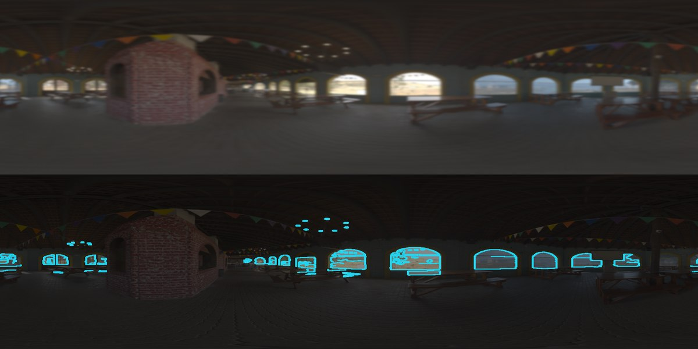
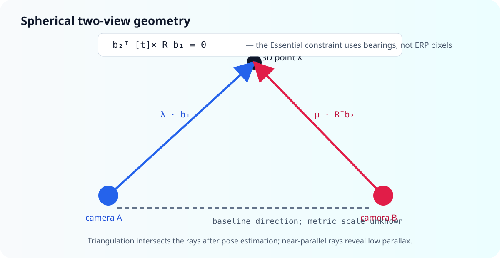
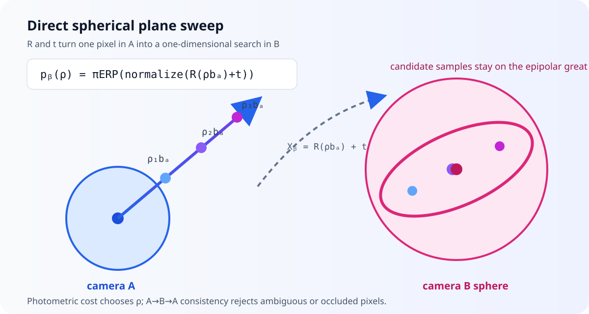

# PanorAi

[](https://pypi.org/project/panorai/)
[](https://pypi.org/project/panorai/)
[](https://github.com/rlsgarcia-code/PanorAi/actions/workflows/ci.yml)
[](https://rlsgarcia-code.github.io/PanorAi/)
[](LICENSE)

**Geometry-safe spherical image processing and projection for computer-vision
applications.**

PanorAi turns central spherical images into explicit projected views, filtered
ERPs, matched bearings, radial range, learned directional evidence, and 3D
structure. Its Stable geometry contract keeps frames, pixel centres, support,
validity, interpolation, and provenance visible; advanced perception and
mapping workflows are labelled Experimental.

## Choose an application


<table width="100%">
  <tr>
    <td width="50%"><a href="docs/tutorials/02_projection_foundations.md"><br><strong>Project and reconstruct panoramic views</strong></a><br><sub>Projection-domain · Stable · <strong>Real output</strong><br>ERP footprints, six faces, reconstructed ERP, support, and round-trip error.</sub></td>
    <td width="50%"><a href="docs/tutorials/spherical_image_processing.md"><br><strong>Process directly on the sphere</strong></a><br><sub>Sphere-native · Experimental · <strong>Real output</strong><br>Constant-angle Gaussian blur and seam-aware geodesic Canny.</sub></td>
  </tr>
  <tr>
    <td width="50%"><a href="docs/tutorials/03_features_and_matching.md"><br><strong>Extract and match visual features</strong></a><br><sub>Projection-domain + spherical mapping · Stable core · <strong>Real output</strong><br>SIFT + FLANN correspondences under a documented 120° cyclic longitude shift.</sub></td>
    <td width="50%"><a href="docs/tutorials/06_spherical_dense_stereo.md"><br><strong>Estimate pose and radial range</strong></a><br><sub>Sphere-native/Hybrid · Experimental · <strong>Method + analytic fixture</strong><br>Registered bearing geometry beside estimated radial range and relative error.</sub></td>
  </tr>
  <tr>
    <td width="50%"><a href="docs/tutorials/05_multiview_reconstruction.md"><br><strong>Reconstruct and navigate</strong></a><br><sub>Hybrid · Experimental · <strong>Method diagram</strong><br>Features, tracks, poses, spherical bundle adjustment, and explicit failure paths.</sub></td>
    <td width="50%"><a href="docs/tutorials/09_spherical_fcn_cam.md"><br><strong>Localize and associate semantic regions</strong></a><br><sub>Sphere-native evidence + hybrid association · Experimental · <strong>Real CAM + method diagram</strong><br>A CAM proposes a region; registered views can support one shared spatial hypothesis.</sub></td>
  </tr>
</table>

Each real-output raster above is tied to a reproducible command, exact
public-source hash, working resolution, and evidence type; conceptual geometry
is explicitly marked as a method diagram. The semantic card deliberately shows
the most legible declared proxy channel; the tutorial retains the full channel
atlas, including failures. A CAM is directional evidence—not a segmentation
mask or calibrated pixel probability. See [provenance](docs/_static/tutorials/ATTRIBUTION.md),
the [evidence policy](docs/evidence/index.rst), and
[how PanorAi executes spherical computer vision](docs/tutorials/spherical_capability_map.md).

## Choose a route

| Application | Strategy | Public entry point | Stability | Tutorial |
| --- | --- | --- | --- | --- |
| Project and reconstruct views | Projection-domain | `EquirectangularImage.views` / `process_views` | Stable | [Projection foundations](docs/tutorials/02_projection_foundations.md) |
| Filter and detect edges | Sphere-native | `panorai.image_processing` | Experimental | [Spherical image processing](docs/tutorials/spherical_image_processing.md) |
| Extract and match features | Projection-domain + spherical mapping | `SphericalFeaturePipeline` | Stable core | [Features and matching](docs/tutorials/03_features_and_matching.md) |
| Estimate pose and radial range | Sphere-native / Hybrid | relative pose and stereo APIs | Experimental | [Two-view geometry](docs/tutorials/04_two_view_geometry.md) · [Dense stereo](docs/tutorials/06_spherical_dense_stereo.md) |
| Reconstruct and navigate | Hybrid | reconstruction and SLAM APIs | Experimental | [Multiview reconstruction](docs/tutorials/05_multiview_reconstruction.md) · [SLAM](docs/tutorials/07_spherical_slam.md) |
| Localize and associate semantic regions | Sphere-native evidence + hybrid association | `panorai.experimental.deep_learning` | Experimental | [FCN/CAM](docs/tutorials/09_spherical_fcn_cam.md) · [spatial hypotheses](docs/tutorials/11_cam_guided_object_hypotheses.md) |

The strategy labels describe *where an operation executes*, not a second API
hierarchy. The [strategy guide](docs/tutorials/spherical_capability_map.md)
connects projection-domain, sphere-native, and hybrid execution to every
application above.

## Install

```bash
pip install panorai==3.7.0
```

PanorAi supports Python 3.11–3.14 and OpenCV `>=4.9,<5`. Optional integrations
remain isolated: install `panorai[torch]`, `panorai[deep-learning]`,
`panorai[deep-learning-depth]`, `panorai[pycolmap]`, `panorai[slam]`, or
`panorai[pcd]` only when the selected application requires them.

## Three starting points

Project, process one face, and reconstruct through the Stable object workflow:

```python
import cv2
import numpy as np
from panorai import EquirectangularImage

erp = np.zeros((512, 1024, 3), dtype=np.uint8)
result = EquirectangularImage(erp).process_views(
    lambda view: cv2.GaussianBlur(view, (5, 5), 1.2),
    layout="cube", size=256, fov=95, blend="gaussian",
)
print(result.image.shape, result.support_mask.shape)
```

Apply a constant-angle neighbourhood directly on the ERP:

```python
from panorai.image_processing import spherical_gaussian_blur

filtered = spherical_gaussian_blur(erp, ksize=5, sigma=1.2)
```

Extract and match local evidence while receiving panorama coordinates and unit
bearings rather than face-local pixels:

```python
from panorai.features import SphericalFeaturePipeline

pipeline = SphericalFeaturePipeline.from_preset("sift-flann")
features_a = pipeline.extract(erp, panorama_id="a")
features_b = pipeline.extract(np.roll(erp, 64, axis=1), panorama_id="b")
matches = pipeline.match(features_a, features_b)
```

Check the [stability matrix](docs/reference/stability.rst) before depending on
an Experimental contract.

---

## 1. Projection

An ERP pixel is a sample of a ray, not a point on a flat image plane. PanorAi
uses one explicit right-handed frame (`+X` right, `+Y` up, `+Z` front) and
pixel-center convention across rays, gnomonic views, cubemaps, and arbitrary-N
overlapping face sets. Sampling declares seam and pole behavior; projection
results keep geometric support, source validity, and interpolation weight
separate.


The quickstart above is the canonical Stable route. RGB, range, labels, and
masks can share its geometric grid while choosing modality-appropriate
interpolation and invalid-data rules. Zero is data; it is never an implicit
invalid marker.

Read: [projection tutorial](docs/tutorials/02_projection_foundations.md),
[custom projection pipeline](docs/tutorials/01_custom_pipeline.md), and the
[exact geometry v1 contract](docs/geometry-v1.md).

---

## 2. Image Processing

PanorAi exposes two intentionally different routes:

```text
sphere-native: ERP ── spherical neighbourhood/filter ──► ERP

multiface:     ERP ── project ──► tangent faces ── planar operation ──►
               faces ── back-project + blend ──► ERP
```

| Property | Direct spherical route | Forward/backward multiface route |
| --- | --- | --- |
| neighbourhood | constant-angle tangent neighbourhood on the sphere | rectangular neighbourhood inside each projected face |
| seams and poles | handled by spherical sampling | handled through overlap plus blending |
| operation | spherical Gaussian/custom convolution, Sobel, Scharr, median, Canny, pyramids | any caller-owned planar operator or model through `process_views` |
| reconstruction | none | required, including a declared blender |
| best fit | filters whose geometry should remain spherical | established planar algorithms and neural networks |

The public APIs make that choice visible rather than implicit:

```text
direct = spherical_gaussian_blur(erp, ksize=5, sigma=1.2, backend="auto")

multiface = EquirectangularImage(erp).process_views(
    lambda view: cv2.GaussianBlur(view, (5, 5), 1.2),
    layout="cube", size=256, fov=95, blend="gaussian",
)
```


On the bundled CC0 panorama resized to 512×1024, a 5×5 Gaussian
(`sigma=1.2`) took **7.99 ms** after warm-up through the direct native route
and **104.25 ms** through six 256² cube faces, OpenCV filtering,
back-projection, and Gaussian blending. In a fixed 37° yaw-equivariance probe,
MAE was **0.00113** and **0.00328**, respectively. These routes are not
bit-identical operators; see the [full protocol and limitations](docs/benchmarks.rst)
and reproduce it with `scripts/benchmark_image_processing_routes.py`.

### Histogram equalization and CLAHE

`spherical_equalize_histogram` is a first-party global equalizer. Its optional
solid-angle weighting avoids over-counting the densely sampled polar rows of an
ERP. PanorAi does **not** currently claim a sphere-native CLAHE implementation.
You can apply OpenCV CLAHE to projected views through `process_views`, but the
result depends on the face layout, FOV, overlap, and blender and is not
equivalent to geodesic contextual equalization. A future spherical CLAHE needs
seam- and pole-safe contextual regions, reproducible interpolation between
regions, and evaluation on downstream feature/pose quality—not only visual
contrast.

Read: [image-processing tutorial](docs/tutorials/spherical_image_processing.md)
and [projection workflow how-to](docs/how_to/index.rst).

### Pretrained spherical FCN/CAM and proxy-guided segmentation

The opt-in `panorai.experimental.deep_learning` namespace converts AlexNet,
VGG16, and ResNet18 classification heads to fully convolutional form, replaces
their spatial convolutions and pools with differentiable spherical operators,
and reuses the exact Torchvision parameters. Checkpoints stay in external
caches; no model weights are packaged. See the [FCN/CAM tutorial](docs/tutorials/09_spherical_fcn_cam.md)
for acquisition, output-stride, map interpretation, and evidence limits.

The same Experimental family provides the InternImage-G/SAM proxy-segmentation
facade and a checksum-pinned Metric3D adapter for resize-free 2:1 ERP radial
range. Both require their documented extras and upstream terms; outputs are
model evidence, not semantic ground truth. See the [segmentation workflow](docs/tutorials/09_spherical_fcn_cam.md#12-one-object-proxy-guided-segmentation-workflow)
and [monocular-depth tutorial](docs/tutorials/10_spherical_monocular_depth.md).

---

## 3. Detection and Feature Extraction

PanorAi separates *where a keypoint is detected* from *how its local appearance
is described*.

| Frontend | Detection | Description | Status |
| --- | --- | --- | --- |
| overlapping faces | OpenCV SIFT, ORB, or AKAZE on gnomonic faces | same OpenCV backend | Stable core |
| spherical DoG | Gaussian/DoG extrema directly on the sphere | one oriented tangent patch per accepted keypoint, then OpenCV SIFT/ORB/AKAZE | Experimental |
| coarse-to-fine spherical DoG | low-resolution proposals followed by full-resolution localization | descriptor-neutral tangent-patch adapter | Experimental |

For relative pose, `SphericalFeaturePipeline.for_relative_pose()` remains the
canonical validated default. Direct spherical DoG is an explicit opt-in while
its public-dataset detection, matching, and pose evaluation is completed.

The spherical detector avoids overlap duplicates and carries position, bearing,
angular scale, response, octave, orientation, and localization validity into a
descriptor-neutral tangent-patch contract. OpenCV still owns SIFT/ORB/AKAZE
descriptor and matcher semantics; optional native kernels accelerate spherical
geometry without changing its reference result.


This real CC0 control uses a known 120° longitude shift in a textured tunnel
whose structure crosses the ERP seam. The older forest
detector/matcher panels remain in the tutorial as regression/generalization
fixtures, not as the product's primary visual scene.

Read: [features and matching](docs/tutorials/03_features_and_matching.md),
[spherical feature how-to](docs/how_to/spherical_features.rst), and
[feature API](docs/reference/features.rst).

---

## 4. Two-View Geometry

PanorAi can estimate a relative pose directly from matched unit bearings—no
COLMAP process is involved:

```text
ERP pair → features → descriptor matches → bearing pairs
         → 5-point Essential hypotheses → spherical MSAC/refit
         → cheirality + degeneracy/quality gates → R₂₁, direction(t₂₁)
```



The estimator scores tangent-Sampson residuals on the sphere, evaluates the
four Essential decompositions, selects translation orientation using
cheirality/parallax evidence, optionally refines rotation and translation
direction, and reports rejection reasons. A returned hypothesis is not
automatically a trustworthy pose: consume `quality_report.accepted`.

Monocular two-view geometry recovers the **direction** of translation, not its
metric magnitude. Metric scale needs an external premise such as a known
baseline, calibrated rig, depth, or a justified scene constraint.

Read: [two-view geometry](docs/tutorials/04_two_view_geometry.md) and the
[public-dataset benchmark](docs/benchmarks.rst).

---

## 5. Stereo Dense Reconstruction

Given two aligned central ERPs and a **known metric** relative pose, the
Experimental stereo route searches inverse radial range directly along
spherical epipolar geometry. It uses angular appearance support, optional
coarse-to-fine search, cost aggregation, sub-hypothesis refinement, and
bidirectional consistency.



The result keeps radial range, confidence, validity, selected cost, and
consistency diagnostics separate. The supplied `R,t` is never silently
re-estimated. If `t` has arbitrary unit length, the reconstructed range has the
same arbitrary scale.

Read: [dense-stereo tutorial](docs/tutorials/06_spherical_dense_stereo.md),
[algorithm derivation](docs/explanation/spherical_dense_stereo.md), and
[current evidence](docs/benchmarks.rst).

## 6. Multi-View Geometry

For three or more panoramas, PanorAi offers two routes:

| Route | PanorAi owns | External owner |
| --- | --- | --- |
| native `SphericalGlobalMapper` | quality-gated pose graph, bearing tracks, rotation/position initialization, triangulation, spherical bundle adjustment, diagnostics | none for geometry |
| PyCOLMAP/COLMAP bridge | virtual-camera geometry, IDs, observations, and database/export contract | PyCOLMAP/COLMAP mapping and optimization |


The native mapper optimizes angular tangent residuals without reconstructing
ERP pixels during bundle adjustment. Its map is arbitrary-scale unless a metric
prior is supplied. The PyCOLMAP route is useful when COLMAP interoperability is
more important than keeping spherical equations first-party; it is an
alternative pipeline, not a hidden dependency of the native mapper.

For registered metric cameras, Experimental metric landmark BA refines supplied
spherical landmarks with a baseline gauge and soft radial-range priors. It
reports sparse landmark support explicitly and does not produce a dense depth map.
Read: [multiview reconstruction](docs/tutorials/05_multiview_reconstruction.md) and [public-dataset benchmark](docs/benchmarks.rst).

---

## Other essential capabilities

The six sections above cover the offline core. Two additional areas should not
be forgotten:

- **Visual SLAM:** incremental ERP or calibrated fisheye tracking,
  keyframes, local mapping, relocalization, and loop correction. Start with the
  [SLAM tutorial](docs/tutorials/07_spherical_slam.md).
- **Contracts and reproducibility:** coordinate frames, units, pixel centers,
  interpolation, invalid-data rules, resolved configuration, provenance, and
  quality gates are part of the result—not incidental metadata. Read the
  [geometry contract](docs/geometry-v1.md), [stability tiers](docs/reference/stability.rst),
  and [benchmark policy](docs/benchmarks.rst).

## Evidence and project boundaries

The [benchmarks and performance page](docs/benchmarks.rst) separates
microbenchmarks from end-to-end accuracy, reports Matterport3D and
Stanford2D3D independently, and distinguishes accepted-result precision from
coverage. Dataset licenses apply; PanorAi does not redistribute those datasets.

PanorAi owns spherical coordinates, projection, masks, provenance, spherical
image-processing kernels, bearing geometry, and its native estimators. OpenCV
owns SIFT/ORB/AKAZE descriptors and standard matchers; optional PyCOLMAP/COLMAP
owns its downstream reconstruction route. See the
[capability map](docs/tutorials/spherical_capability_map.md) for the complete
sphere-native, projection-domain, and hybrid boundary.

## Reference

- [Documentation home](docs/index.rst)
- [Tutorials in workflow order](docs/tutorials/index.rst)
- [API reference](docs/reference/index.rst)
- [Changelog](CHANGELOG.md)
- [License](LICENSE)

PanorAi's distributed source is MIT licensed. Optional upstream projects,
models, and datasets retain their own terms.
