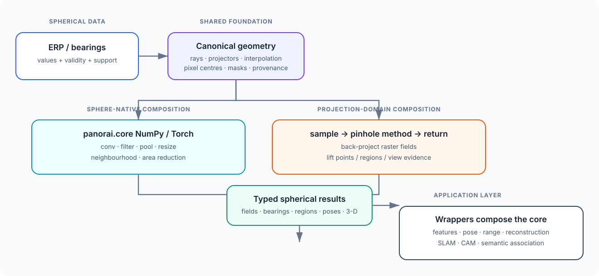

Architecture
============

PanorAi separates mathematical geometry, evidence-producing domains, and
evidence integration. Product families organize user goals; Python packages
remain domain boundaries rather than mirroring the navigation hierarchy.

The user-facing spherical computer-vision guide is maintained in
:doc:`../guides/tutorials/spherical_capability_map`. It starts from what users can do
across projection, image processing, features and matching, two-view geometry,
multiview reconstruction, and SLAM. Within each theme it identifies
sphere-native, projection-domain, and hybrid routes, independently from C++
acceleration.

         explicit support mask that meet again in mask-aware reconstruction.
   :width: 100%

Canonical geometry
------------------

``panorai.geometry`` owns the coordinate frame, projection formulas, sampling,
layouts, dtype rules, and support masks. Functional calls and immutable
projector objects delegate to one engine so NumPy, Torch, cubemap, and
gnomonic paths do not redefine the mathematics independently.

Fundamental operations and composition
--------------------------------------

``panorai.core`` defines immutable specifications and small spherical
operations. ``panorai.core.numpy`` is the required implementation path and
``panorai.core.torch`` is the explicit optional differentiable path. Both
consume the same geometry-v1 lattice and tangent-neighbourhood mathematics;
native acceleration is an execution choice, not a second numerical contract.

Applications compose these primitives with ordinary language/backend
constructs. They do not require a PanorAi pipeline merely to add, subtract,
branch, concatenate, or apply pointwise nonlinearities. The typed container
boundary lives in ``panorai.workflow``: a composed model runs directly on an
array/tensor and uses ``predict`` only when it must extract fields from or
materialize fields into ``EquirectangularImage``.

Compatibility containers
------------------------

``EquirectangularImage``, ``GnomonicFace``, and ``GnomonicFaceSet`` retain the
3.0 object-oriented workflow. In 3.1 they can accept canonical geometry specs,
but they remain compatibility APIs rather than the source of new geometry
semantics.

Validity and blending
---------------------

Projection returns data together with geometric support. A valid black RGB
pixel, label zero, or radial range zero remains valid when its mask is true.
An unsupported non-zero value remains unsupported. Blenders consume those
explicit masks and never infer validity from numeric values.

Scope boundary
--------------

Training pipelines, datasets, checkpoints, research metrics, and vendored
model implementations are outside the projection core and are excluded from
the 3.1 wheel and sdist. ``panorai.depth`` contains only lazy compatibility
adapters to separately installed upstream projects; PCD remains an optional
compatibility surface. See
:doc:`../reference/stability` for the supported surface and
:doc:`../geometry-v1` for the mathematical contract.

Evidence and graph boundary
---------------------------

Image processing, features, pose, depth, semantics, reconstruction, stereo,
and SLAM own their algorithms and result contracts. ``panorai.graph`` consumes
those prepared results. Its builder does not detect, match, infer depth, run a
network, estimate pose, perform SLAM, or choose a provider.

This direction is intentional:

.. code-block:: text

   explicit providers / existing PanorAi domains
                    |
                    v
       typed observations and pair evidence
                    |
          association + spatial posterior
                    |
                    v
       entity lifecycle and lineage events
                    |
                    v
         immutable snapshot -> JSONL/NPZ -> query

Views, semantic region observations, and entity hypotheses are distinct node
types. Scale-free and unbounded posteriors remain non-metric; metric summaries
are derived only from finite metric support. Correlation groups prevent
repeated transformations of the same observation from creating false
confidence, and the conservative-v1 policy requires at least two independent
views before entity confirmation.

Version boundary
----------------

The 3.x line introduces ``core`` and ``workflow`` additively. The generic
Torch layers used by ``panorai.ops.spherical.nn`` are Stable on CPU; the
remaining low-level specifications, backend facades and workflow adapters keep
their separately recorded tiers. It does not remove or warn on established
imports.
Physical canonical-package changes remain a 4.0 decision and are published in
:doc:`../development/migration-4.0`.
