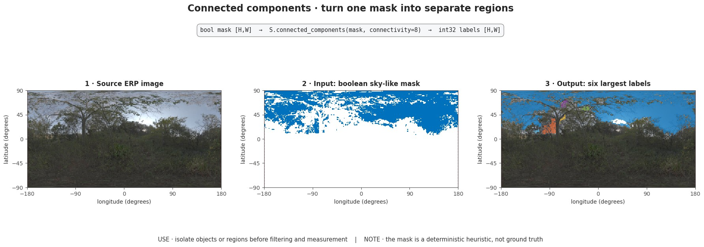
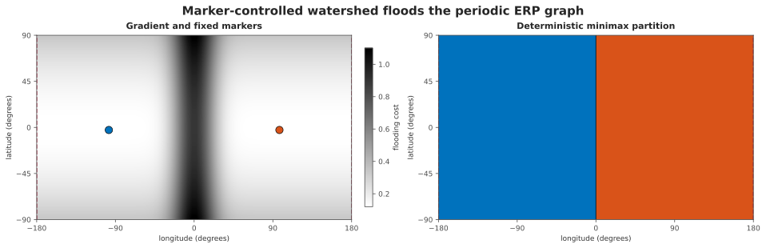
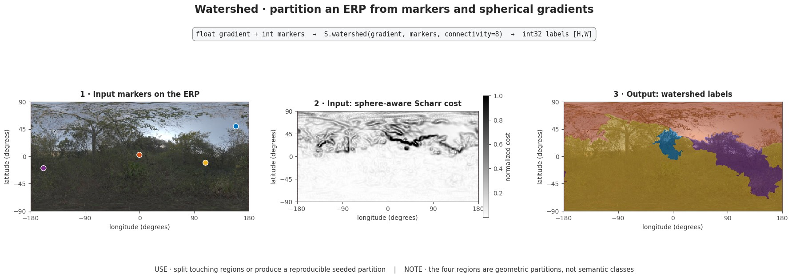
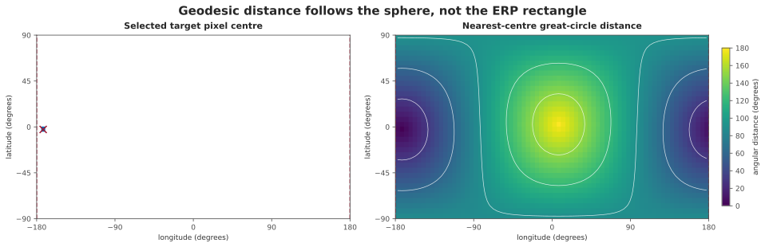
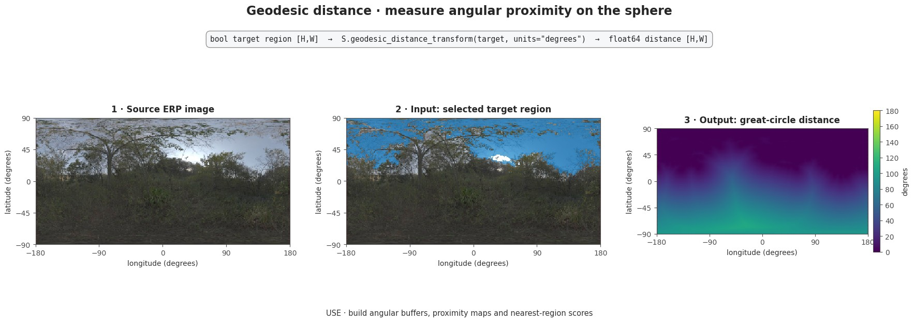
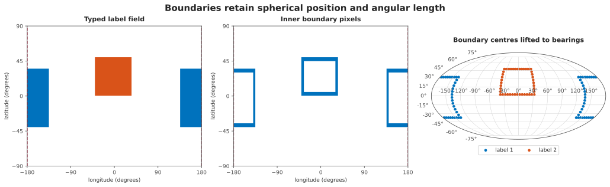
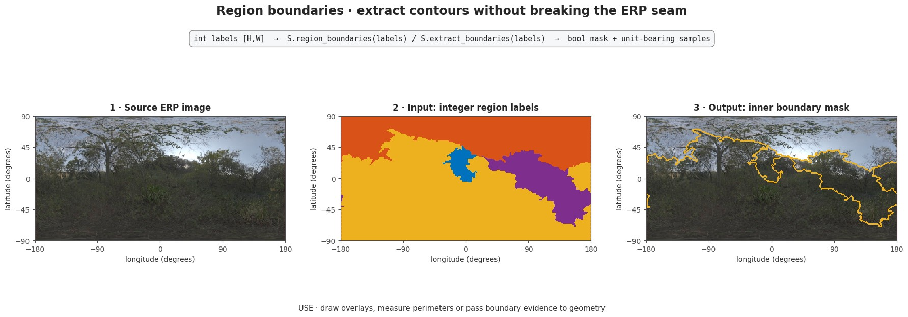
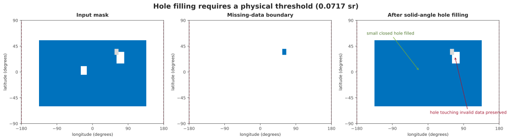
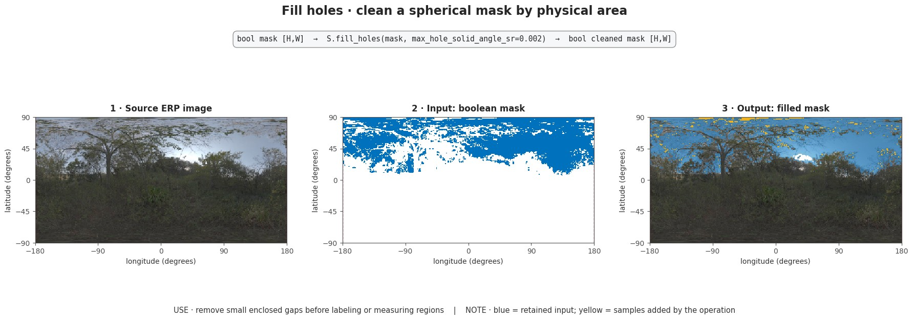
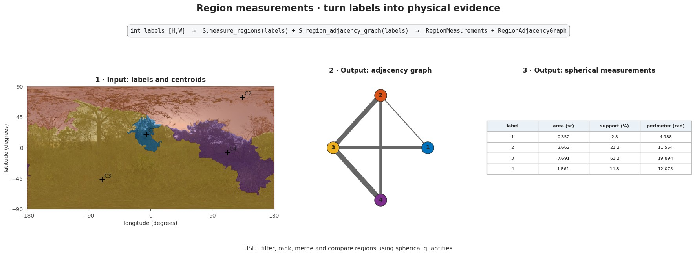

Spherical region analysis
=========================

Region analysis turns masks or label fields into topology and geometry.  A
planar implementation is not sufficient for an ERP: its left and right edges
are the same meridian, its pixels cover unequal solid angles, and a missing
band must not connect regions merely because its numeric values are zero.

Each capability below is shown twice. The analytic figure isolates the
mathematical contract; the real-image figure checks integration on the
checksum-pinned CC0 Nature Reserve Forest panorama. Its sky-like mask is a
documented photometric heuristic, not semantic ground truth.

Read every real-image figure from left to right. The boxed line states the
actual public call as ``input type → S.operation(...) → output type``;
numbered panels show those values; the final ``USE`` line states what that
result enables in an application. The photograph is gamma-lightened for
legibility only. All operations consume the original decoded values after the
sphere-aware resize.

Topology contract
-----------------

``connected_components`` uses 4- or 8-neighbour ERP pixel-centre adjacency
with periodic longitude.  Latitude does not wrap. Unsupported or invalid
pixels are absent vertices, so they cannot bridge components. Positive labels
are deterministic and ordered by the first raster index of each component;
zero is background.

.. figure:: ../_static/tutorials/region-analysis-connected-components.svg
   :alt: A seam-crossing ERP mask, an invalid barrier, and the resulting periodic connected-component labels.
   :width: 100%

   Longitude is periodic, latitude is not, and invalid samples are absent from
   the topology. The seam-crossing blue region therefore receives one label;
   the gray barrier separates the central region.

   Real-image check. The source is loaded through ``EquirectangularImage`` and
   resized sphere-aware. The six largest components are selected by solid
   angle for display; the computation retains all 112 components.

``watershed`` floods the same graph from positive integer markers. It
minimizes the maximum gradient along a path, then path length; the smaller
marker label resolves a remaining tie. Marker pixels never change. This is a
declared discrete graph watershed, not a planar watershed applied to an ERP
rectangle.

   Marker-controlled watershed operates on the same periodic graph. Fixed
   markers and deterministic tie-breaking make the partition reproducible.

   Real-image check. Each marker is the lowest Scharr cost inside one of four
   fixed windows. The resulting regions follow real image ridges; they are
   geometric partitions, not semantic classes.

Distance and boundaries
-----------------------

``geodesic_distance_transform`` builds unit bearings for ERP centres and
returns the exact great-circle angle to the nearest selected centre. Values
outside support or validity are NaN, not zero. ``region_boundaries`` uses
topological neighbours and never invents a boundary at the longitude seam.

Angular perimeter is measured along cell interfaces. North-south interfaces
have length :math:`\Delta\phi`; east-west interfaces at latitude
:math:`\phi` have length :math:`\cos(\phi)\Delta\lambda`. Solid angle comes
from the existing spherical core and sums to :math:`4\pi` over a complete
ERP. Centroids are normalized solid-angle-weighted bearing sums. Symmetric
regions whose vector sum is undefined return ``None`` rather than an arbitrary
direction.

   Equal colors mean equal angular distance on the sphere. They do not form
   Euclidean circles in the ERP rectangle, and the field remains continuous
   across the two displayed longitude edges.

   Real-image check. Distance is evaluated from every ERP centre to the
   largest connected sky-like candidate and reported in degrees.

   Raster boundaries can be retained as a typed mask or lifted to unit
   bearings. No artificial contour is introduced where the ERP is cut for
   display.

   Real-image check. The yellow inner boundaries follow the real-image
   watershed and remain continuous at the longitude seam.

Holes on a closed sphere
------------------------

A sphere has no privileged exterior component. ``fill_holes`` therefore
requires ``max_hole_solid_angle_sr``. It fills only background components no
larger than that physical area and never fills a component touching missing
support or invalid data. The threshold is part of the scientific method, not
an implementation detail.

   The physical threshold fills the small closed component. A component that
   touches missing data remains unresolved instead of being silently treated
   as an interior hole.

   Real-image check. Yellow samples are background components no larger than
   ``0.002 sr`` that were filled; blue samples were already selected by the
   photometric heuristic.

Measurements and adjacency
--------------------------

``measure_regions`` and ``region_adjacency_graph`` expose complementary
descriptions of a label field. Per-region values use spherical area,
solid-angle-weighted centroids and angular perimeter. Graph edges store shared
angular boundary length rather than a count of ERP pixels.

.. figure:: ../_static/tutorials/region-analysis-measurements.svg
   :alt: Four ERP regions with spherical centroids, their adjacency graph, and a table of physical measurements.
   :width: 100%

   The raster, graph and table describe the same four regions. Measurements
   remain comparable across latitude because they are expressed in steradians
   and radians rather than raw pixel counts.

   Real-image check. The four partitions cover :math:`4\pi`; their centroid,
   area, perimeter and five adjacency edges are computed from spherical
   geometry rather than ERP pixel counts.

API placement
-------------

Functions and configured raster operations live in
``panorai.ops.spherical``. Configured operations compose through
``EquirectangularImage.apply_spherical`` or ``OnSphere`` and safely persist in
a Pipeline. ``SphericalWatershed`` is a two-field Stage; ``AnalyzeRegions``
turns a label field into ``RegionAnalysisResult``. Immutable measurements,
adjacency graphs, conservative enclosing caps and boundary samples live in
``panorai.data``.

The boundary type intentionally stores unordered pixel-centre bearing samples,
not a polygon. Applications requiring an ordered sub-pixel contour must use a
future contour contract rather than infer ordering from these samples.

This surface is Experimental. It does not yet include spherical
skeletonization or an ordered contour/polygon tracer.
