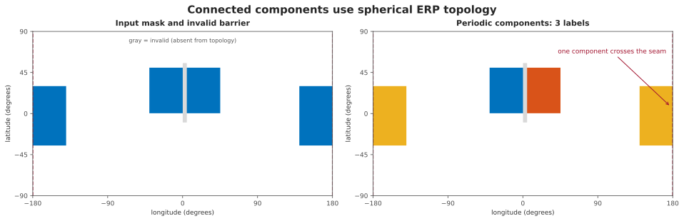
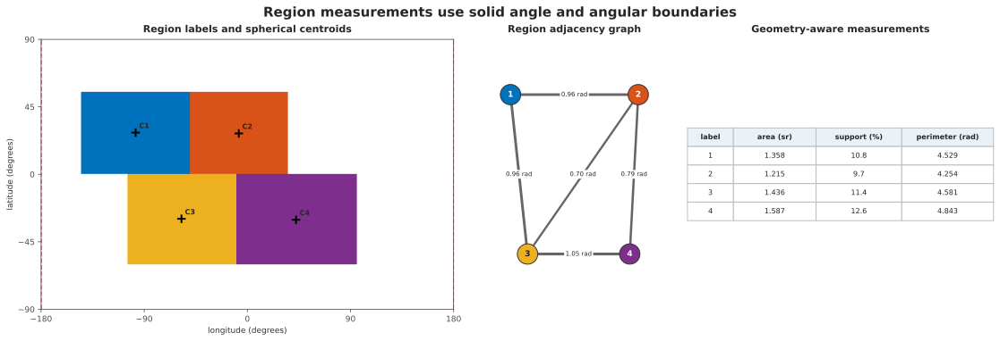

Analyze regions on a sphere
===========================

Start from a boolean mask and keep support and validity explicit.

.. code-block:: python

   import numpy as np

   from panorai.ops import spherical as S

   mask = np.zeros((180, 360), dtype=bool)
   mask[70:110, :20] = True
   mask[70:110, -20:] = True  # the same seam-crossing region
   support = np.ones_like(mask)
   validity = np.ones_like(mask)

   labels = S.connected_components(
       mask,
       support=support,
       validity=validity,
       connectivity=8,
   )
   measurements = S.measure_regions(
       labels,
       support=support,
       validity=validity,
   )
   assert labels.max() == 1
   print(measurements.regions[0].solid_angle_sr)

   The first practical check is the seam: samples at the left and right image
   edges can belong to the same spherical component.

The same operation can be inspected and persisted in a Pipeline.

.. code-block:: python

   from panorai import EquirectangularImage
   from panorai.data import RasterFieldSpec
   from panorai.pipeline import AnalyzeRegions, OnSphere, Pipeline

   panorama = EquirectangularImage.from_field(
       "mask",
       mask,
       spec=RasterFieldSpec.categorical(),
       support=support,
       valid=validity,
   )
   pipeline = Pipeline(
       OnSphere(S.ConnectedComponents(8), input="mask", output="labels"),
       AnalyzeRegions(),
   )
   region_evidence = pipeline(panorama)

For multi-field marker-controlled segmentation, attach a floating ``features``
gradient and integer ``labels`` markers to one ``EquirectangularImage``, then
run ``SphericalWatershed``. ``AnalyzeRegions`` consumes a label-bearing
container and returns measurements, a region adjacency graph and optional
boundary samples.

.. code-block:: python

   from panorai.pipeline import AnalyzeRegions, SphericalWatershed

   partition = Pipeline(SphericalWatershed())(panorama_with_gradient_and_markers)
   evidence = Pipeline(AnalyzeRegions())(panorama_with_partition_labels)

Use ``geodesic_distance_transform(mask, units="degrees")`` when an angular
distance is the desired result. Use ``fill_holes`` only with a justified
solid-angle threshold; there is no canonical exterior on a closed sphere.

Choose the output that matches the next step
--------------------------------------------

- Keep ``labels`` when another raster operation or Pipeline Stage follows.
- Use ``region_boundaries`` for a typed boundary mask.
- Use ``extract_boundaries`` when downstream geometry needs unit bearings.
- Use ``measure_regions`` for physical region measurements.
- Use ``region_adjacency_graph`` for graph reasoning and merging policies.

   One label field can feed raster processing, geometric lifting, tabular
   measurements and a region adjacency graph without changing coordinate
   conventions.

See :doc:`the concept <../../concepts/spherical-region-analysis>` for exact
topology and measurement semantics and :doc:`the operations reference
<../../reference/spherical_ops>` for the public members.
