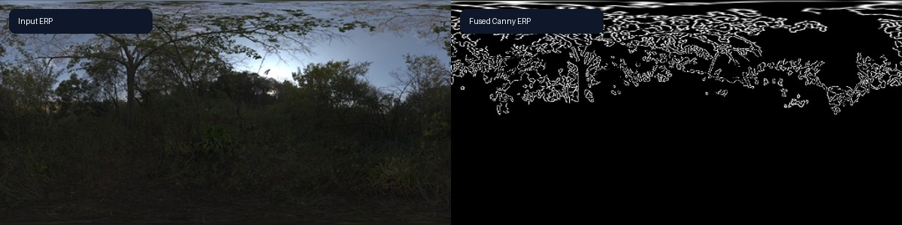
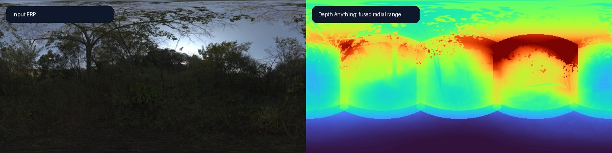
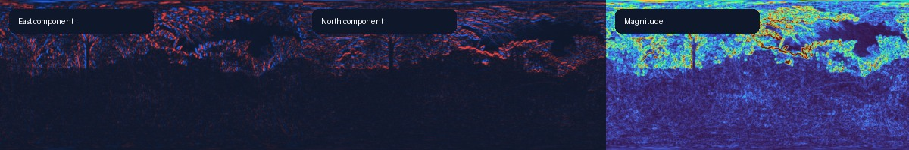
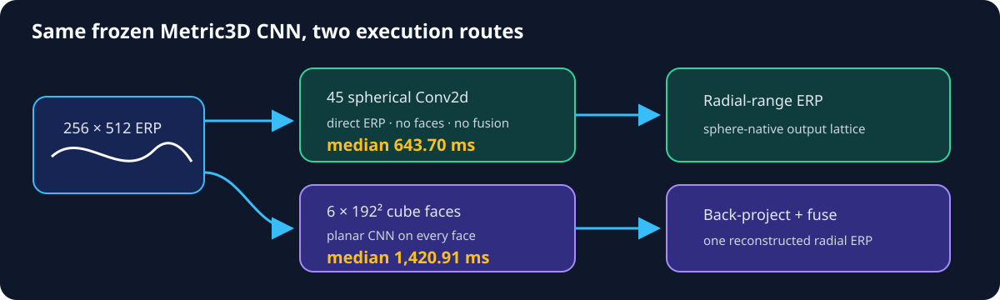

PanorAi
========

Build computer-vision methods for spherical images by processing sampled
pinhole views or by composing operations directly on the ERP sphere.

Three objects
-------------

``EquirectangularImage`` is the complete spherical raster.
``GnomonicFace`` is one pinhole view. ``GnomonicFaceSet`` returns the views
together for processing, lifting and fusion.

1. Apply pinhole methods over the sphere
-----------------------------------------

Start with one operation
~~~~~~~~~~~~~~~~~~~~~~~~

.. code-block:: python

   views = panorama.views("icosahedron", size=512, fov=100)
   blurred = views.map(planar_blur)
   result = blurred.reconstruct(blend="gaussian")

.. image:: _static/tutorials/pinhole-workflow-sundowner.jpg
   :alt: ERP, sampled views, blurred views and fused ERP result

Sampling chooses centres, resolution, FOV and overlap. Every output returns
through its own ``face.spec``. Fusion combines only supported, valid samples:
``average`` and ``gaussian`` handle continuous fields; ``closest`` preserves
labels and masks. See :doc:`reference/samplers_blenders`.

Combine pinhole operations
~~~~~~~~~~~~~~~~~~~~~~~~~~

Use ``process_views()`` when the callback produces one raster. A callback can
compose Gaussian smoothing and Canny, for example, and the method returns the
fused ERP.

The same route accepts pretrained planar models: the
:doc:`Depth Anything view adapter <applications/pose_range/depth_anything_views>`
adds tangent intrinsics, axial-to-radial conversion, validity and fusion while
leaving the upstream model unchanged.

2. Operate directly on the sphere
---------------------------------

One native operation
~~~~~~~~~~~~~~~~~~~~

.. code-block:: python

   from panorai.core.numpy import SphericalGradient

   components = SphericalGradient(operator="scharr")(gray_nchw)
   magnitude = np.hypot(components[:, 0::2], components[:, 1::2])

The result is already an ERP; no views or fusion are created.

.. list-table:: Public 256×512 gradient comparison
   :header-rows: 1

   * - Route
     - Median time
     - Yaw MAE
   * - Native C++ spherical Scharr
     - 1.89–1.91 ms
     - 0.00405
   * - Cube → OpenCV → fusion
     - 22.61–27.71 ms
     - 0.00515

Two macOS arm64 trials, 15 reused calls each; not a universal ranking. See
:ref:`image-processing-routes`.

Compose operations
~~~~~~~~~~~~~~~~~~

.. code-block:: python

   smooth_0 = blur_sigma_1(gray_nchw)
   dog_0 = blur_sigma_2(gray_nchw) - smooth_0
   octave_1 = resize_half(smooth_0)
   dog_1 = blur_sigma_2(octave_1) - blur_sigma_1(octave_1)

.. image:: _static/tutorials/spherical-dog-pyramid.jpg
   :alt: Input ERP and three sphere-native DoG octaves

The same :doc:`core operations <reference/core_operations>` provide
``SphericalConv2d``, ``SphericalResize``, ``SphericalMaxPool2d``, gradients and
reductions in NumPy/C++ and Torch.

Convert pretrained CNNs
~~~~~~~~~~~~~~~~~~~~~~~

Experimental adapters retain learned parameters and replace planar spatial
layers with spherical convolution, transposed convolution and pooling. The
converted CNN consumes the ERP directly.

.. code-block:: python

   metric3d = load_spherical_metric3d_convnext_tiny_v1(
       accept_upstream_terms=True, cache_dir=model_cache, device="cpu"
   )
   radial_range_m = metric3d.model(rgb_nchw_float32)

.. list-table:: Public 256×512 Metric3D execution comparison
   :header-rows: 1

   * - Route
     - Median
     - P95
   * - Native spherical CNN
     - 643.70 ms
     - 655.62 ms
   * - Six 192² faces + fusion
     - 1,420.91 ms
     - 1,427.17 ms

CPU, five calls after warm-up. This is execution evidence, not accuracy; the
checkpoint is not redistributed because its terms are unresolved. See
:doc:`Metric3D depth <tutorials/10_spherical_monocular_depth>`.

.. code-block:: python

   fcn = ImageNetFCN(loaded.model, "resnet18").eval()
   port_module_with_report(fcn)
   dense = fcn.forward_dense(normalized_erp).logits
   cam = class_activation_map(dense, 975, output_shape=rgb.shape[:2])

.. image:: _static/tutorials/spherical-cam-imagenet-lakeside.jpg
   :alt: Sphere-native ImageNet ResNet18 CAM for lakeside

See :doc:`ImageNet CAM <tutorials/09_spherical_fcn_cam>`.

3. Return the right spherical output
------------------------------------

.. list-table::
   :header-rows: 1

   * - Face result
     - Return path
     - Spherical result
   * - Dense image, depth, labels or C-channel logits
     - ``map()`` + ``reconstruct()``
     - ``EquirectangularImage``
   * - Keypoints or point detections
     - ``map_points()`` + angular NMS
     - ``SphericalPointSet``
   * - Boxes, polygons or masks
     - ``map_regions()`` + solid-angle NMS
     - ``SphericalRegionSet``
   * - Whole-view scores or embeddings
     - ``map_views()`` + coverage aggregation
     - ``SphericalViewSet``

Dense channels remain aligned and are fused independently. Points become unit
bearings for detection or feature matching; regions retain spherical support;
view embeddings are aggregated without counting overlap twice. See
:doc:`explanation/workflow-evolution` and the runnable
:doc:`tutorials/00_quick_start`.

.. code-block:: python

   dense = views.map(predict_logits, output="logits", spec=logit_spec)
   points = views.map_points(detect_keypoints, source_id="features")
   regions = views.map_regions(detect_boxes, source_id="detector")
   evidence = views.map_views(embed_face, source_id="encoder")

Use ``SphericalFeaturePipeline`` when extraction and descriptor matching should
be handled by a ready-made facade rather than composed from point callbacks.

.. toctree::
   :hidden:
   :maxdepth: 2

   start/index
   applications/index
   capabilities/index
   concepts/index
   papers/index
   reference/index
   evidence/index
   development/index
   releases/index
