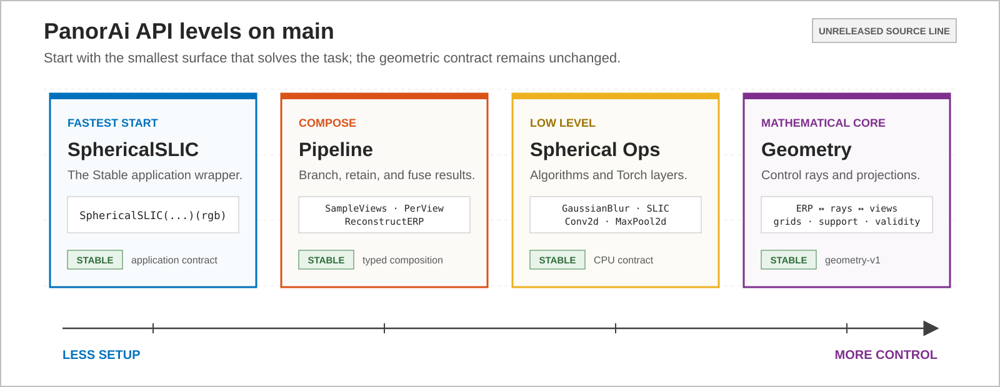

PanorAi
========

Build spherical-image workflows without losing the geometry that gives their
outputs meaning. Start with a ready-made application; move toward geometry only
when the task needs more control.

         Spherical Ops to Geometry, ordered from less setup to more control.
   :width: 100%

Quick start
-----------

The shortest Stable workflow segments an equirectangular RGB panorama directly
on the sphere. Input is ``HWC`` float RGB; output is a typed integer label field
with its grid, support and validity beside the values.

.. literalinclude:: ../scripts/run_documentation_examples.py
   :language: python
   :start-after: DOCS_LEVEL_APPLICATION_START = None
   :end-before: DOCS_LEVEL_APPLICATION_END = None
   :dedent: 4

Continue with the :doc:`ten-minute quick start <getting-started/index>` to
inspect the result and reveal the equivalent Pipeline.

Choose an API level
-------------------

.. grid:: 1 2 2 4
   :gutter: 2

   .. grid-item-card:: 1. Applications
      :link: guides/api-levels/applications
      :link-type: doc

      Solve an established task with one configured wrapper.

      **Start with:** ``SphericalSLIC``

      **Stable:** SLIC wrapper

   .. grid-item-card:: 2. Pipeline
      :link: guides/api-levels/pipeline
      :link-type: doc

      Compose direct-sphere and projected-view stages, branches and outputs.

      **Start with:** ``Pipeline`` + ``OnSphere``

      **Stable:** generic composition

   .. grid-item-card:: 3. Spherical Ops
      :link: guides/api-levels/spherical_ops
      :link-type: doc

      Apply filters, transforms, algorithms and Torch layers on spherical
      lattices.

      **Start with:** ``GaussianBlur``

      **Stable:** general ops; SLIC

   .. grid-item-card:: 4. Geometry
      :link: guides/api-levels/geometry
      :link-type: doc

      Control rays, projections, interpolation, grids, support and validity.

      **Start with:** ``erp_pixels_to_rays``

      **Stable:** ``geometry-v1``

The levels are not competing APIs. An Application may expose its Pipeline; a
Pipeline may contain Spherical Ops; both ultimately obey the same Geometry
contract. Moving right exposes more decisions without changing coordinates or
data semantics.

``EquirectangularImage`` is the common input object across all four levels, not
a fifth level. Start with :doc:`open, resize, rotate, crop, filter and save
<guides/tutorials/equirectangular_image>` when entering from an image-oriented
workflow.

Learn progressively
-------------------

Each level has the same three-part route:

.. list-table:: Tutorial, concept and reference routes
   :header-rows: 1
   :widths: 16 31 28 25

   * - Level
     - Tutorial: build it
     - Concept: understand it
     - Reference: look it up
   * - Applications
     - :doc:`Run and configure a wrapper <guides/api-levels/applications>`
     - :doc:`Application wrappers <concepts/application-wrappers>`
     - :doc:`Applications API <reference/applications>`
   * - Pipeline
     - :doc:`Compose sphere and view stages <guides/api-levels/pipeline>`
     - :doc:`Typed composition <concepts/pipeline-composition>`
     - :doc:`Pipeline API <reference/pipeline>`
   * - Spherical Ops
     - :doc:`Use functions, objects and layers <guides/api-levels/spherical_ops>`
     - :doc:`Sphere-aware operations <concepts/spherical-operations>`
     - :doc:`Operations API <reference/spherical_ops>`
   * - Geometry
     - :doc:`Work with pixels, rays and views <guides/api-levels/geometry>`
     - :doc:`Geometry contract <concepts/geometry-contract>`
     - :doc:`Geometry API <reference/geometry>`

Already know the role you need?  Open the :doc:`component catalog
<reference/catalog/index>` to compare every Application, Stage, spherical
operation, estimator, typed result and Geometry primitive.  The catalog also
links to an exhaustive inventory generated from the public API contract.

What remains invariant
----------------------

Every level follows ``geometry-v1``: pixel-centre coordinates, top-left image
origin, ``+X`` right, ``+Y`` up, ``+Z`` forward, longitude ``[-pi, pi)``, and
north-to-south latitude. Depth means radial range unless another quantity is
named. Geometric support, data validity and numeric value are distinct; black
RGB, label zero and range zero are not missing merely because they are zero.

The :doc:`stability reference <reference/stability>` is authoritative. A Stable
Pipeline does not promote an Experimental operation or application placed
inside it.

Explore by outcome
------------------

After learning the four levels, use the :doc:`capability guides <guides/index>`
for projection and processing, features and matching, pose and range, semantic
regions, reconstruction and SLAM. These guides combine API levels around a
computer-vision outcome.

.. toctree::
   :hidden:
   :maxdepth: 2

   getting-started/index
   guides/index
   concepts/index
   reference/index
   development/index
   releases/index
   research/index
