# Manual de uso do PanorAi Workbench

O PanorAi Workbench é a aplicação first-party para descobrir, executar e
inspecionar a API pública do PanorAi instalada no backend. Este manual cobre o
uso local do Catálogo, Runner, Single View, Two View, Multi View e do fluxo
experimental de mapeamento planar por altura conhecida.

> **Estado do produto.** O Workbench é uma ferramenta local em evolução. A
> estabilidade exibida em cada componente pertence à superfície pública do
> PanorAi; ela não transforma o Workbench inteiro em uma API Stable.

As telas abaixo foram capturadas em 15 de novembro de 2026. O cabeçalho de cada
tela identifica o runtime realmente usado. Números de versão, contagens e
componentes podem mudar; os significados dos estados e as regras do fluxo
permanecem os mesmos, mas o estado de um componente específico depende do
runtime capturado.

## 1. Iniciar a aplicação

No clone do repositório, abra dois terminais no diretório `workbench/`.

No primeiro terminal, instale o PanorAi em modo editável, instale as dependências
do backend e inicie a API:

```bash
python -m pip install -e ..
python -m pip install -e '.[dev]'
uvicorn panorai_workbench.api:app --app-dir backend \
  --host 127.0.0.1 --port 8000
```

No segundo terminal, inicie o frontend:

```bash
npm install
npm run dev
```

Abra <http://127.0.0.1:5173/>. Mantenha os dois processos ativos enquanto usa
o Workbench.

Se o objetivo for testar um wheel já instalado, não reinstale `..`. Use um
ambiente que já contenha as dependências do Workbench declaradas em
`pyproject.toml`, instale o Workbench com `--no-deps` e confirme a origem do
PanorAi:

```bash
python -m pip install -e '.[dev]' --no-deps
python scripts/validate_installed_panorai.py --forbid-source-root ..
```

`--no-deps` protege o wheel do PanorAi, mas também deixa FastAPI, Uvicorn,
Pillow e as demais dependências do Workbench sob responsabilidade do ambiente.
O validador informa `panorai.__file__`, versão, tipo de instalação e commit. O
painel **Runtime ativo**, no Catálogo, apresenta as mesmas informações.

## 2. Começar por “O que posso fazer?”

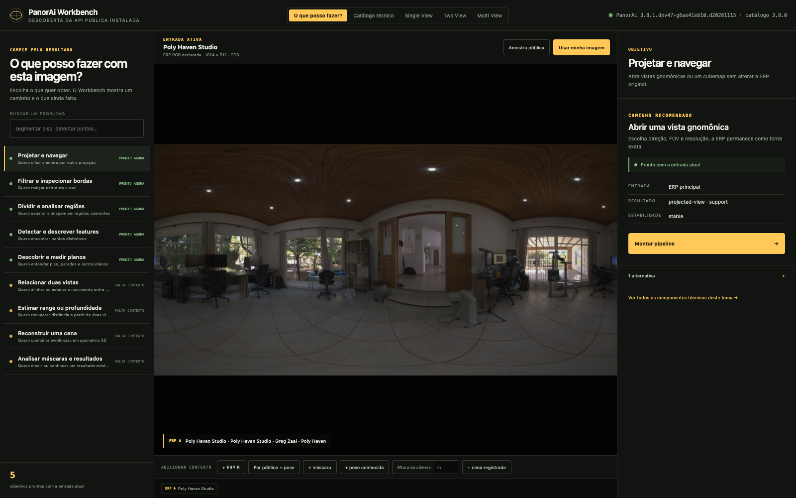

Ao abrir `/`, o Workbench carrega a ERP interna **Poly Haven Studio (CC0)** e
mostra objetivos em linguagem de problema. Nenhuma análise da imagem ocorre
nessa etapa: as recomendações usam apenas os tipos e o contexto declarado.

1. escolha um objetivo à esquerda ou busque por expressões como “segmentar
   piso”, “encontrar pontos”, “profundidade” e “alinhar panoramas”;
2. confira no inspetor o caminho recomendado, entradas exigidas, resultado e
   estabilidade;
3. adicione ERP B, pose, máscara, altura ou cena registrada quando necessário;
4. abra **Alternativas** para comparar até três outros caminhos;
5. clique em **Montar pipeline** somente quando quiser preparar o fluxo.

Os estados significam:

- **pronto agora:** o runtime e o contexto atual satisfazem o contrato;
- **falta contexto:** a própria tela nomeia a entrada que falta;
- **indisponível:** a alternativa continua visível com o diagnóstico de
  dependência, modelo ou runtime. Nada é instalado ou baixado automaticamente.

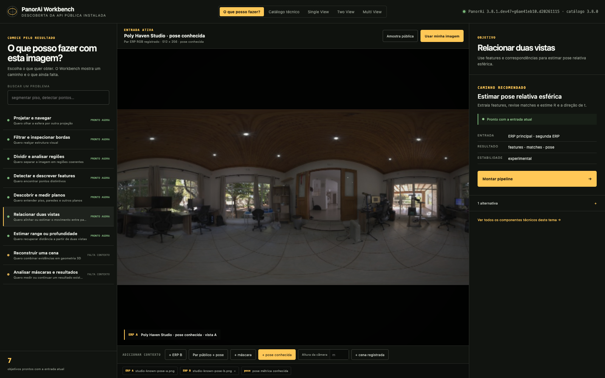

Ao adicionar o par público, **Relacionar duas vistas** muda para “pronto agora”.
Stereo pode continuar indisponível se a instalação ativa não publicar um
runner compatível; possuir duas imagens e pose não autoriza o Workbench a
inventar uma implementação.

### Montar não significa executar

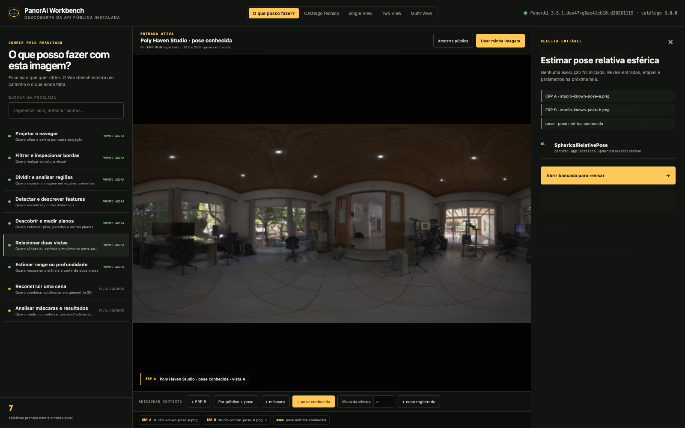

A receita lista inputs e componentes emitidos pelo backend e declara
explicitamente que nenhuma execução começou. **Abrir bancada para revisar** ou
**Revisar e editar no Runner** transfere os arquivos pelo armazenamento local
do navegador. A tela de destino ainda exige a ação humana de executar.

## 3. Abrir o Catálogo técnico

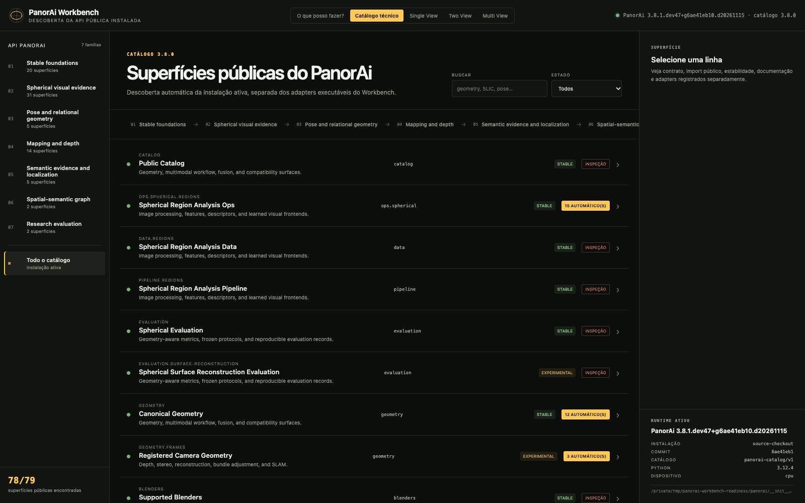

A barra superior abre cinco áreas principais:

- **O que posso fazer?:** descoberta por objetivo e contexto;
- **Catálogo técnico:** inventário completo da API pública instalada;
- **Single View:** uma ERP e uma sequência de operações compatíveis;
- **Two View:** duas ERPs, features, correspondências, pose e estéreo;
- **Multi View:** uma cena registrada, regiões planares e reconstrução.

O **Runner** não é uma sexta aba superior. Ele é o executor contextual aberto
por **Montar pipeline** ou por um componente executável do Catálogo técnico.

No Catálogo técnico, use as famílias à esquerda, a busca e o filtro de estado. Cada
linha distingue estabilidade e disponibilidade:

- **automático / executável:** o contrato tipado é suficiente para o Runner;
- **adapter:** existe uma experiência especializada no Workbench;
- **inspeção:** o símbolo é público, mas não é um executável autônomo;
- **indisponível / requer entrada:** falta uma dependência opcional, entrada
  tipada anterior, modelo ou configuração explícita.

Selecione uma linha para ver o import público, documentação, contrato e atalhos.
O navegador nunca escolhe livremente um módulo Python: ele envia somente IDs
emitidos pelo catálogo instalado.

## 4. Executar uma operação em Single View

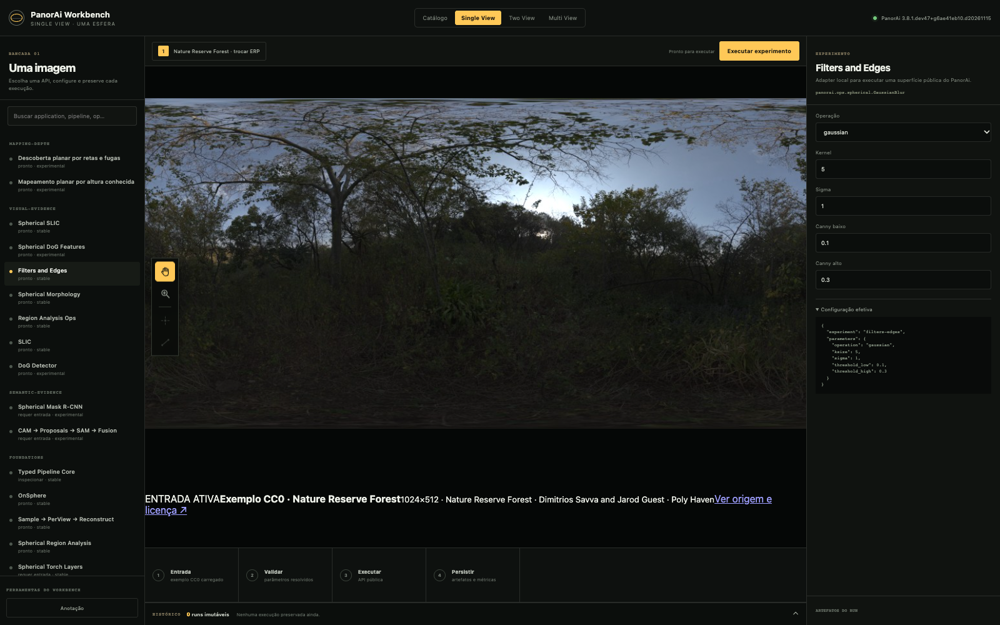

1. Escolha um componente na lista à esquerda ou use a busca.
2. Use a amostra pública carregada automaticamente ou clique no nome da entrada
   para trocar a ERP por um arquivo local.
3. Ajuste os parâmetros no painel direito. **Configuração efetiva** mostra o
   documento que será executado.
4. Clique em **Executar experimento**.
5. Inspecione a visualização, as etapas do run, os artefatos e o histórico.

A amostra é somente um ponto de partida. Um upload local a substitui para o run
seguinte; ele não altera a amostra rastreada nem muda o contrato científico.

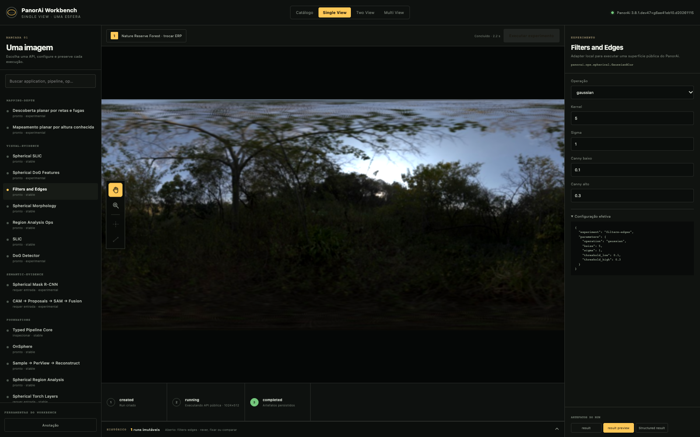

Cada execução cria um run imutável. A faixa inferior distingue `created`,
`running` e `completed`; o histórico permite reabrir, fixar ou comparar runs.
No painel **Artefatos do run**, o artefato exato permanece separado do preview
derivado e do resultado estruturado.

Máscaras e labels usam nearest-neighbour. Suporte, validade e valor não são
sinônimos: preto interno continua válido quando a máscara de validade assim o
declara.

## 5. Montar um plano no Runner universal

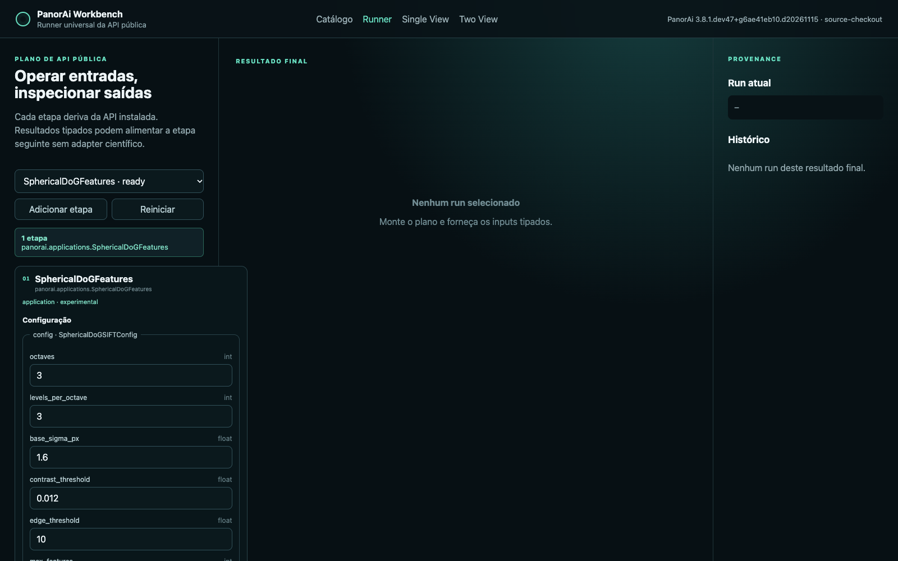

O Runner é a superfície genérica para componentes bem tipados:

1. escolha um componente marcado como `ready`;
2. clique em **Adicionar etapa**;
3. preencha a configuração gerada a partir das dataclasses e tipos públicos;
4. forneça os inputs solicitados ou ligue-os ao resultado compatível de uma
   etapa anterior;
5. clique em **Executar plano público**.

O Runner aceita uma sequência linear tipada. Ele rejeita referências futuras,
ciclos, campos desconhecidos, tipos incompatíveis e imports arbitrários. Um
resultado público tipado pode alimentar a etapa seguinte sem adapter científico.
O frontend ainda não é um editor geral de grafos com ramificações.

Modalidade também faz parte do contrato. Um campo `panorai:scalar-raster`
aceita uma imagem realmente monocanal ou um `.npy` HW; uma imagem RGB não é
convertida silenciosamente em grayscale. Da mesma forma, a ERP RGB padrão não
torna um histograma escalar “pronto agora”.

## 6. Trabalhar com um par em Two View

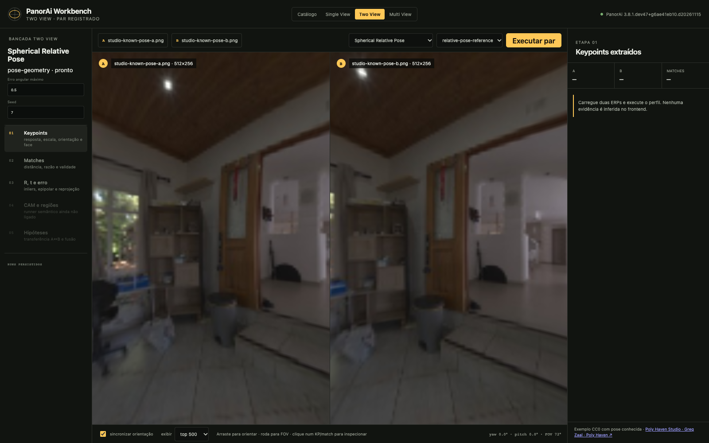

Two View carrega duas imagens públicas distintas por padrão. Para trocar uma
delas, clique no botão **A** ou **B** no topo. Em seguida:

1. escolha o experimento, por exemplo **Spherical Relative Pose** ou uma opção
   de estéreo;
2. selecione o perfil de features quando o experimento o oferecer;
3. ajuste os parâmetros à esquerda;
4. clique em **Executar par**.

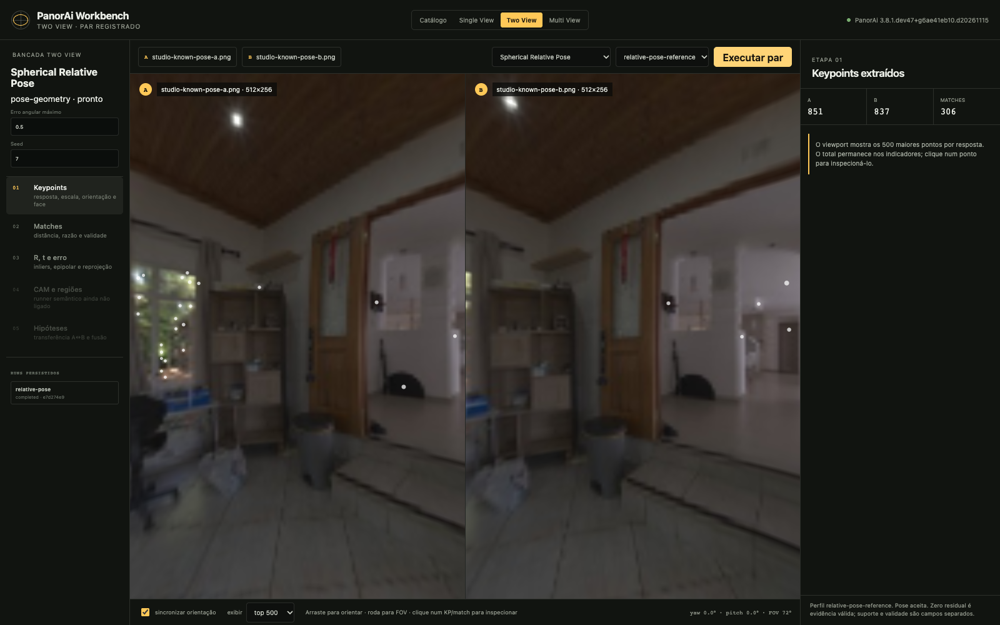

As etapas **Keypoints**, **Matches** e **R, t e erro** separam a evidência. Os
indicadores mostram as contagens totais; o seletor `top 250/500/1000/todos`
limita somente o que é desenhado. Arraste para orientar as duas cartas
gnomônicas, use a roda para mudar o FOV e clique em um ponto ou match para
inspecioná-lo. A opção **sincronizar orientação** mantém as vistas alinhadas.

Para estéreo, o resultado mantém range radial, confiança e validade em canais
separados. Uma região sem validade não é convertida silenciosamente em range
zero.

## 7. Revisar uma cena em Multi View

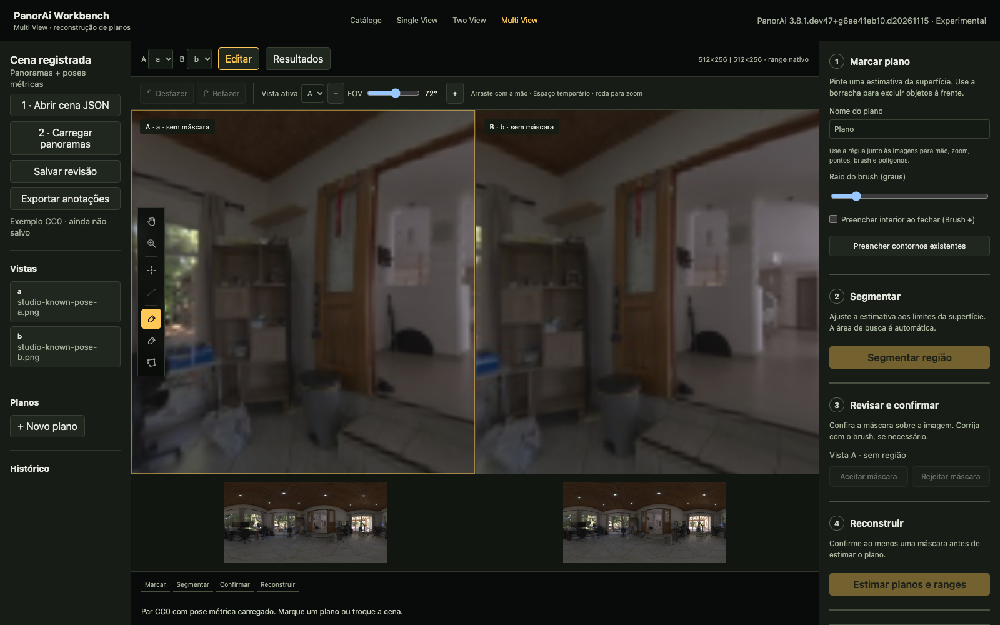

Multi View usa panoramas e poses métricas de uma cena registrada:

1. abra uma cena JSON e carregue as imagens, ou use o par público padrão;
2. selecione as vistas A e B;
3. crie um plano e marque uma estimativa com brush ou polígono;
4. execute a segmentação;
5. revise e aceite ou rejeite a máscara;
6. execute **Estimar planos e ranges** somente depois da revisão humana;
7. salve a revisão ou exporte as anotações.

As cartas gnomônicas são vistas de edição; a geometria canônica continua na
esfera. Desfazer/refazer, zoom, vista ativa e contexto ERP permanecem
sincronizados. Uma proposta automática nunca é tratada silenciosamente como
ground truth.

## 8. Mapear planos com altura conhecida

Abra `/known-height-planar.html` diretamente ou escolha **Mapeamento planar por
altura conhecida** em Single View.

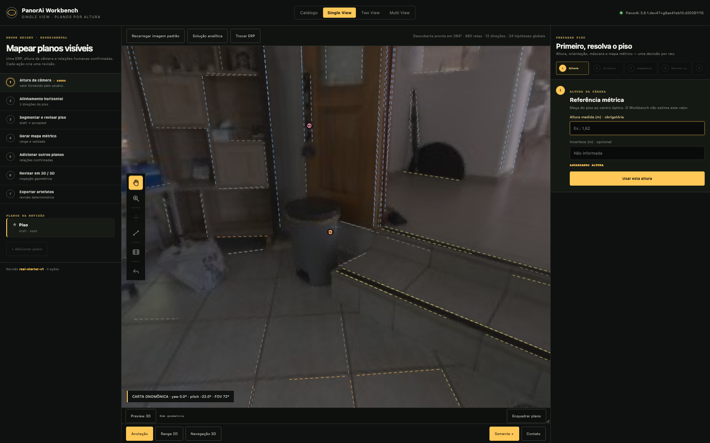

O fluxo começa com uma amostra pública interna, apropriada para experimentar a
segmentação de piso, paredes e teto. A primeira decisão é sempre humana:

1. informe a altura medida entre o piso e o centro óptico;
2. opcionalmente informe a incerteza da altura;
3. clique em **Usar esta altura**;
4. oriente o piso com descoberta assistida ou marcação manual;
5. segmente, revise e aceite a máscara do piso;
6. gere o mapa métrico;
7. adicione outros planos e confirme relações e contatos;
8. revise em 2D/3D e exporte os artefatos.

O Workbench não estima a altura. Uma orientação draft, uma posição draft e uma
máscara aceita são estados diferentes. Apenas geometria com as aceitações
necessárias publica range científico.

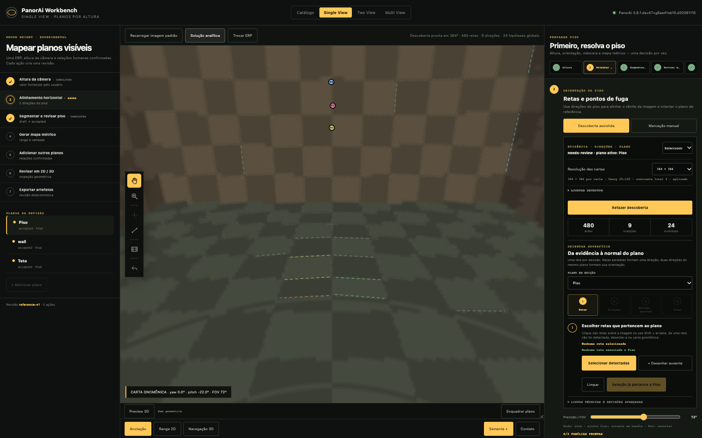

Na descoberta assistida:

- **retas** são observações ajustadas em cartas gnomônicas;
- uma **direção** reúne retas que convergem para o mesmo ponto de fuga;
- duas ou mais direções não paralelas associadas à mesma superfície determinam
  a **orientação de um plano**;
- **expandir direção** procura outras retas geometricamente compatíveis, mas a
  inclusão continua revisável;
- a segmentação delimita a extensão visível do plano; ela não inventa sua
  orientação ou posição.

Use **Solução analítica** apenas como exemplo guiado dos estados esperados. Use
**Recarregar imagem padrão** para recomeçar e **Trocar ERP** para trabalhar com
uma imagem própria. O Preview 3D diferencia orientação sem posição, plano draft
posicionado e plano métrico resolvido.

## 9. Dependências opcionais e modelos

Torch, Open3D, SAM e outros backends permanecem opcionais. Quando uma
dependência falta, o componente fica indisponível e o diagnóstico informa o
extra necessário. O Workbench não instala pacotes nem baixa checkpoints
silenciosamente.

Aceitar termos ou iniciar uma aquisição pela interface, quando oferecido, é uma
ação explícita. Checkpoints, datasets e outputs locais não fazem parte do
repositório nem do wheel principal do PanorAi.

## 10. Runs, provenance e arquivos locais

No modo local, runs, uploads e artefatos ficam abaixo de
`PANORAI_WORKBENCH_HOME` ou, por padrão, em
`outputs/workbench/projects/scratch`. Um run registra componente, superfície,
checksums dos inputs, configuração resolvida, runtime, eventos, métricas,
avisos e artefatos versionados.

Para não escrever no checkout, defina um diretório explícito antes de iniciar o
backend:

```bash
PANORAI_WORKBENCH_HOME=/tmp/panorai-workbench-runs \
  uvicorn panorai_workbench.api:app --app-dir backend \
  --host 127.0.0.1 --port 8000
```

## 11. Segurança e encerramento

O Workbench ainda não implementa autenticação, autorização, isolamento de
tenant ou sandbox para uploads não confiáveis. Use somente `127.0.0.1`; não o
exponha à LAN, a um proxy reverso ou à internet.

Para encerrar, pressione `Ctrl+C` no terminal do Vite e no terminal do Uvicorn.
O histórico persistido não é apagado por esse procedimento.

## 12. Solução de problemas

- **Frontend abre, mas não há catálogo:** confirme que o Uvicorn está ativo e
  que o proxy aponta para a porta correta.
- **A versão testada não é a esperada:** execute
  `python scripts/validate_installed_panorai.py --forbid-source-root ..` e
  confira o caminho no painel Runtime ativo.
- **Componente está em inspeção:** ele pode ser um tipo auxiliar, abstrato ou
  exigir resultado tipado de uma etapa anterior.
- **Componente está indisponível:** leia o diagnóstico; instale manualmente o
  extra autorizado ou forneça a entrada/checkpoint solicitado.
- **Run foi cancelado:** artefatos finais não são publicados; uma chamada
  nativa já em execução só libera memória quando retorna.
- **A amostra não apareceu:** recarregue a página e confirme que backend e
  frontend usam o mesmo checkout. Single View, Two View e o fluxo por altura
  conhecida devem carregar exemplos públicos automaticamente.

Para implantação local com PostgreSQL e armazenamento S3 compatível, consulte
[Local operational deployment](operations.md). Essa configuração também é
loopback-only enquanto autenticação estiver fora do escopo.
